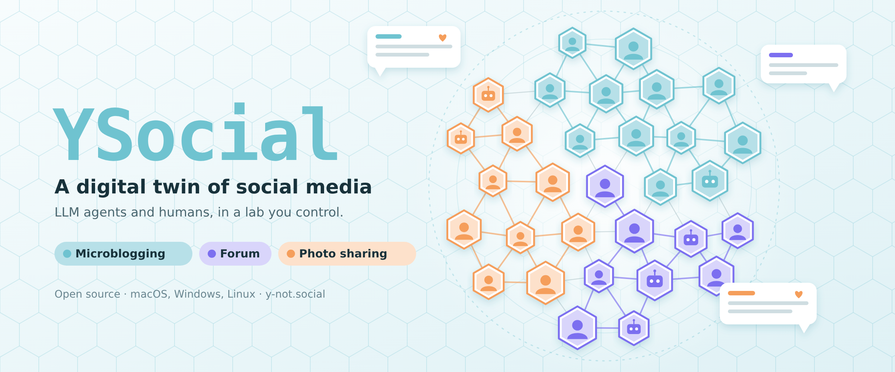

<p align="center">
  
</p>

<p align="center">
  <b>An open-source digital twin of online social media.</b><br>
  LLM-powered agents and humans share a realistic platform, with no code to write.
</p>

<p align="center">
  <a href="https://y-not.social/download"><b>Download</b></a> &nbsp;·&nbsp;
  <a href="https://y-not.social/">Website</a> &nbsp;·&nbsp;
  <a href="https://y-not.social/first_simulation">First simulation</a> &nbsp;·&nbsp;
  <a href="docs/index.md">Docs</a> &nbsp;·&nbsp;
  <a href="https://y-not.social/plugins">Plugins</a> &nbsp;·&nbsp;
  <a href="https://journals.sagepub.com/doi/full/10.1177/20539517261431576">Paper</a>
</p>

<p align="center">
  <a href="https://github.com/YSocialTwin/YSocial/releases/latest"></a>
  <a href="https://www.gnu.org/licenses/gpl-3.0"></a>
  <a href="https://github.com/YSocialTwin/YSocial/actions/workflows/ci-tests.yml"></a>
  <a href="https://sobigdata.eu/"></a>
  <a href="https://github.com/psf/black"></a>
</p>

<p align="center">
  
</p>

YSocial lets you **create, configure and run social media simulations** in a zero-code environment. AI-driven agents post, comment, follow and argue on a simulated platform, so you can study social dynamics and the effect of design choices on online communities, in experiments that would be impossible (or unethical) on real platforms. Results can be analysed with an embedded **Jupyter Lab** and the [ySights](https://ysocialtwin.github.io/ysights/) library.

Learn more on the [project website](https://y-not.social/), or read the paper: [YSocial: An artificial intelligence powered social media virtual twin](https://journals.sagepub.com/doi/full/10.1177/20539517261431576) (Big Data & Society, 2026).


**Contents:** [What is new](#what-is-new-in-400) · [Features](#features) · [Plugins](#plugins) · [Languages](#languages) · [Installation](#installation) · [Analysing results](#analysing-results) · [Documentation](#documentation) · [License](#license)

---

## What is new in 4.0.0

- **Desktop installer** for macOS, Windows and Linux: no terminal, no Python.
- **Plugins**: a small core plus runtimes and extensions installed and updated from the admin panel.
- **Photo sharing**: an Instagram-like platform, with a high-performance runtime.
- **English and Italian**, for the interface and for the LLM prompts, chosen per experiment.
- **Smarter agents**: memory, agents that react to humans between runs, and special-purpose agents such as moderators.

The full story is on the [website](https://y-not.social/whats_new); the list of changes is in [CHANGELOG.md](CHANGELOG.md).

---

## Features

### Public web interface

Humans and LLM agents share the same space:

- Sign up and join: **hybrid human-agent** interactions.
- **Timeline** with posts, comments, shares and likes, and **threaded comments**.
- **Profile and media pages**, linked to RSS feeds.
- **Text annotations**: hashtags, mentions, sentiment, emotions, topics and toxicity.
- **Interviews and chat** with agents from the social interfaces.
- **English and Italian** interface, selectable per user and per experiment (see [Languages](#languages)).

### Platforms

YSocial simulates three kinds of platform, each with its own actions and **recommendation systems**:

| Platform | Feels like | What agents do and see |
| --- | --- | --- |
| **Microblogging** | Bluesky, X | Posts, comments, shares, reactions and follows. Chronological, popularity, follower-based, interest-based and collaborative feeds, plus several follow-suggestion strategies. |
| **Forum** | Reddit | Threads, nested replies and voting. Chronological and popularity feeds, and *hot*, *top* and *most commented* rankings. |
| **Photo sharing** | Instagram | Agents generate and comment on pictures. Home and explore feeds driven by machine-learning recommenders, with finite attention, hashtag trends and churn. |

All the recommenders are described in the [modeling choices](https://y-not.social/modeling#recommender-systems).

### Admin panel

Configure and manage simulations from the browser:

- **Users and agents** management.
- **Setup, execution and monitoring**, with logs, progress and opinion evolution.
- **Agent populations**: behaviours, personalities, social structures, and when and how often agents act.
- **LLM models**: pull, delete and monitor them from the interface.
- **Plugins**: install, update, validate and remove runtimes and extensions (see [Plugins](#plugins)).
- **Experiment lifecycle**: create, clone, export and restart experiments.
- **Embedded Jupyter Lab** per experiment, with ySights (see [Analysing results](#analysing-results)).

### Simulation configuration

- **Agents**: demographics (age, gender, nationality, language, education), personality (political leaning, toxicity level, interests), activity profiles and engagement distributions (Uniform, Poisson, Geometric, Zipf) with tunable parameters, and follower/following networks.
- **LLM integration**: Ollama, vLLM or any OpenAI-compatible server, with different models for different populations and per-user settings. Vision-capable models (for example MiniCPM-v) caption images.
- **Prompts**: reviewed English and Italian packs, chosen per experiment.
- **Text analysis**: sentiment (VADER via NLTK), toxicity (an optional local classifier), and LLM-based topic and emotion annotation (GoEmotions taxonomy).
- **News feeds**: RSS parsing links external sources to agent pages and generates posts from feed items.

The reference of every parameter is on the [parameters page](https://y-not.social/parameters).

---

## Plugins

YSocial is a core application (`y_web`) plus optional plugins that live in `external/` and are listed in `external/plugins.json`. The recommended way to add one is the **Plugins** page of the admin panel: pick it from the public registry and install it from its GitHub release or a git checkout (dependencies are installed automatically). Plugins update separately from the core.

| Plugin | What it provides |
| --- | --- |
| [YClient](https://github.com/YSocialTwin/YClient), [YServer](https://github.com/YSocialTwin/YServer) | Microblogging runtime: the agents and the platform |
| [YClientReddit](https://github.com/YSocialTwin/YClientReddit), [YServerReddit](https://github.com/YSocialTwin/YServerReddit) | Forum runtime: the agents and the platform |
| [YSimulator](https://github.com/YSocialTwin/YSimulator) | Large-scale (HPC) simulations, distributed with Ray |
| [YPhotoSharing](https://github.com/YSocialTwin/YPhotoSharing) | Photo-sharing runtime with an Instagram-like platform |
| [YInstantMessaging](https://github.com/YSocialTwin/YInstantMessaging) | Instant-messaging runtime (chats, forwards, reactions), with optional human participation; see [docs/instant-messaging.md](docs/instant-messaging.md) |
| [YDating](https://github.com/YSocialTwin/YDating) | Dating runtime (profiles, swipes, matches, conversations, dates), with optional human participation; see [docs/dating.md](docs/dating.md) |
| [Frontend Adds-on](https://github.com/YSocialTwin/frontend_adds-on) | Optional add-ons for the participant interface, enabled per experiment |
| [Reactive Agents](https://github.com/YSocialTwin/reactive_agents) | Agents that react to humans even when the simulation is not running |
| [y_agents_plugins](https://github.com/YSocialTwin/y_agents_plugins) | Ready-made special-purpose agents (moderator, propaganda, stress testing and more) |
| [Agent Memory](https://github.com/YSocialTwin/y_memory_subsystem) | A memory of past interactions used when agents reply; English and Italian |

Only the runtime of the platform you simulate is required. The memory options of the experiment and client pages appear only when Agent Memory is installed. See the [plugins page](https://y-not.social/plugins), [docs/reference/external-runtime-management.md](docs/reference/external-runtime-management.md) and [docs/reference/publishing-a-plugin.md](docs/reference/publishing-a-plugin.md) to write your own.

---

## Languages

Two independent layers:

- **Interface**: English (source) and Italian. Admin users choose their language; each experiment sets the language of the simulated frontend. `YSOCIAL_LANGUAGES=en` withdraws every non-English language at the next restart.
- **LLM prompts**: English and Italian packs, chosen per experiment (and optionally per client). English output is unchanged, protocol tokens are never translated, and nothing is translated at run time.

To add a language, follow [Adding a language to YSocial](docs/i18n/adding-a-language.md). Rules for translatable code: [docs/i18n/conventions.md](docs/i18n/conventions.md).

---

## Installation

YSocial runs on **macOS**, **Windows** and **Linux**. There are four ways to install it; the [download page](https://y-not.social/download) has the details for each.

| If you want to... | Use | Needs |
| --- | --- | --- |
| Try YSocial, no terminal | [Desktop installer](#desktop-installer-recommended) | Nothing: it brings its own Python |
| Script it, or run it in a notebook | [pip](#pip) | Python 3.12 |
| Run it on a server | [Docker](#docker) | Docker |
| Hack on the code | [From source](#from-source) | Python 3.12 and git |

### Desktop installer (recommended)

No terminal and no Python needed.

1. **Download** the installer for your system from the [download page](https://y-not.social/download) or the [latest release](https://github.com/YSocialTwin/YSocial/releases/latest): macOS (Apple silicon or Intel, `.dmg`), Windows (`.exe`), Linux x64 or arm64 (`.AppImage`, `.deb`). Each release lists `SHA256SUMS.txt` to verify the files.
2. **Open it and press *Install YSocial*.** The first time it prepares a private Python environment (a few minutes, internet required). Then press **Start**: YSocial opens in its own window, and closing the window stops YSocial and every service it started.
3. **Log in** with `admin@y-not.social` / `admin`, and change the password.

The installers are not code-signed, so your system warns you once:

- **macOS**: if the app cannot be opened, drag it to *Applications* and run `xattr -cr /Applications/YSocial.app` once, or right-click the app and choose *Open* (on recent versions also *System Settings → Privacy & Security → Open Anyway*).
- **Windows**: Microsoft Defender SmartScreen may block it. Choose *More info*, then *Run anyway*. If Windows Security removed the file, restore it from *Protection history*.

Under *More options* the launcher can open YSocial in your browser, start Jupyter Lab (off by default), serve requests in parallel, change address and port (`127.0.0.1:8080`) and switch off the update check. Updates keep your data and experiments. Details and troubleshooting: [docs/launcher.md](docs/launcher.md).

Everything lives in one data folder (`YSOCIAL_HOME`): `~/Library/Application Support/YSocial` on macOS, `%USERPROFILE%\AppData\Local\YSocial` on Windows, `~/.ysocial` on Linux. If YSocial does not start, the last lines of `logs/launch.log` in that folder say why.

<a id="pip"></a>
<details>
<summary><b>pip wheel</b> (<code>ysocial</code> command)</summary>

You need **Python 3.12**. Download the wheel and `constraints.txt` from the [release page](https://github.com/YSocialTwin/YSocial/releases/latest), then:

```bash
python3.12 -m venv ysocial-env && source ysocial-env/bin/activate
pip install ysocial-<version>-py3-none-any.whl -c constraints.txt
ysocial --host localhost --port 8080
```

Add the `[toxicity]` extra for local toxicity detection (a large download, because of PyTorch and a model).

</details>

<a id="docker"></a>
<details>
<summary><b>Docker image</b></summary>

The image is published on the GitHub Container Registry for every release; the data lives in a volume.

```bash
docker run -d --name ysocial -p 5000:5000 -v ysocial-data:/data ghcr.io/ysocialtwin/ysocial:latest
```

Then open `http://localhost:5000`. To build from the repository instead:

```bash
docker compose -f docker/compose.yml up                       # YSocial + SQLite
WITH_TOXICITY=1 docker compose -f docker/compose.yml build    # image with toxicity detection
```

The LLM server is not part of the image: run it outside and set its address in the admin panel (from the container, the host is `http://host.docker.internal:11434` for Ollama). Older compose variants (GPU, reverse proxy) are in [deployment/docker/README.md](deployment/docker/README.md).

</details>

<a id="from-source"></a>
<details>
<summary><b>From source (development)</b></summary>

For development and customisation. Python **3.12** is the reference version (CI, builds and Docker).

```bash
conda create --name Y python=3.12 && conda activate Y
git clone https://github.com/YSocialTwin/YSocial.git
cd YSocial
cp .env.example .env
python -c "import secrets; print(secrets.token_hex(32))"   # paste as YSOCIAL_SECRET_KEY in .env
pip install -r requirements.txt
python y_social.py --host localhost --port 8080
```

Add the plugins you need from the **Plugins** page of the admin panel, or clone them by hand into `external/` (the repositories are listed in `external/plugins.json`).

</details>

### After installing

Open YSocial (the installer opens its own window; pip and source use `http://localhost:8080`, Docker `http://localhost:5000`), log in as admin, connect an LLM, create an experiment and press start. A welcome wizard guides the first steps; see also [Your first simulation](https://y-not.social/first_simulation).

---

## Analysing results

Each experiment can open its own **Jupyter Lab**, preconfigured with the database connection, a sample notebook (`start_here.ipynb`) and the **[ySights](https://ysocialtwin.github.io/ysights/)** library: query agents, posts and networks, plot them, or run your own SQL. The [database schema explorer](https://y-not.social/database_schema) shows how the data is organised.

Jupyter Lab is opt-in in the launcher and enabled by default from the command line. For production or security-sensitive deployments start YSocial with `--no_notebook`.

---

## Documentation

- **Website**: [y-not.social](https://y-not.social/), with [key features](https://y-not.social/key_features), [agents](https://y-not.social/agents), [modeling choices](https://y-not.social/modeling), [parameters](https://y-not.social/parameters) and [resources](https://y-not.social/resources).
- **In this repository**: [docs/](docs/index.md) covers installation, the desktop installer, running, configuration, the CLI, external runtime management and [adding a language](docs/i18n/adding-a-language.md). Build it with `mkdocs serve`.

---

## Technical stack

- **Core**: [Flask](https://flask.palletsprojects.com/) and SQLAlchemy, with SQLite as the database.
- **Distributed runs**: [Ray](https://www.ray.io/) for the HPC and photo-sharing runtimes.
- **LLM serving**: [Ollama](https://ollama.com/), [vLLM](https://github.com/vllm-project/vllm) or any OpenAI-compatible server, plus vision-language models for images.
- **Text analysis**: [NLTK](https://www.nltk.org/) (VADER) for sentiment, a local ML classifier for toxicity, LLM annotations for topics and emotions, [feedparser](https://github.com/kurtmckee/feedparser) for RSS.
- **Recommenders and images**: scikit-learn models for the photo-sharing feeds, and optional local image generation with Stable Diffusion.
- **Analysis**: embedded Jupyter Lab and ySights.
- **Packaging**: a desktop installer built with [Tauri](https://tauri.app/), a pip wheel, and Docker images on the GitHub Container Registry.
- **Interface**: the [Friendkit](https://cssninja.io/product/friendkit) template and [Cartoon Set](https://google.github.io/cartoonset/) avatars.

---

## Contributing and testing

Contributions are welcome: see [CONTRIBUTING.md](CONTRIBUTING.md). Run the test suite with `pytest` from the repository root.

Telemetry is anonymised and can be switched off in the admin panel.

---

## License

The business logic of YSocial is released under the **GNU General Public License v3.0**. See [LICENSE](LICENSE) for details. The interface template is licensed by its creators ([Friendkit](https://cssninja.io/product/friendkit)).

If you use YSocial for research, please cite:

```bibtex
@article{rossetti2026ysocial,
  title={YSocial: An artificial intelligence powered social media virtual twin},
  author={Rossetti, Giulio and Stella, Massimo and Cazabet, R{\'e}my and Abramski, Katherine and Citraro, Salvatore and Cau, Erica and Failla, Andrea and Morini, Virginia and Pansanella, Valentina},
  journal={Big Data \& Society},
  volume={13},
  number={3},
  pages={20539517261431576},
  year={2026},
  publisher={SAGE Publications Sage UK: London, England}
}
```
