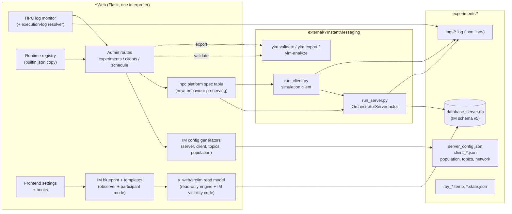
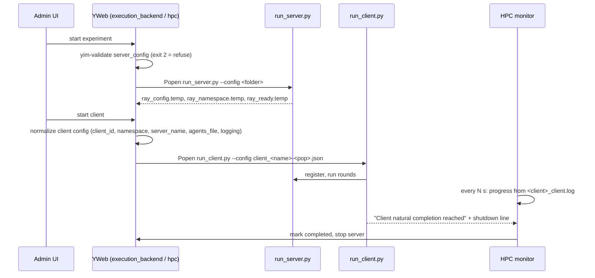
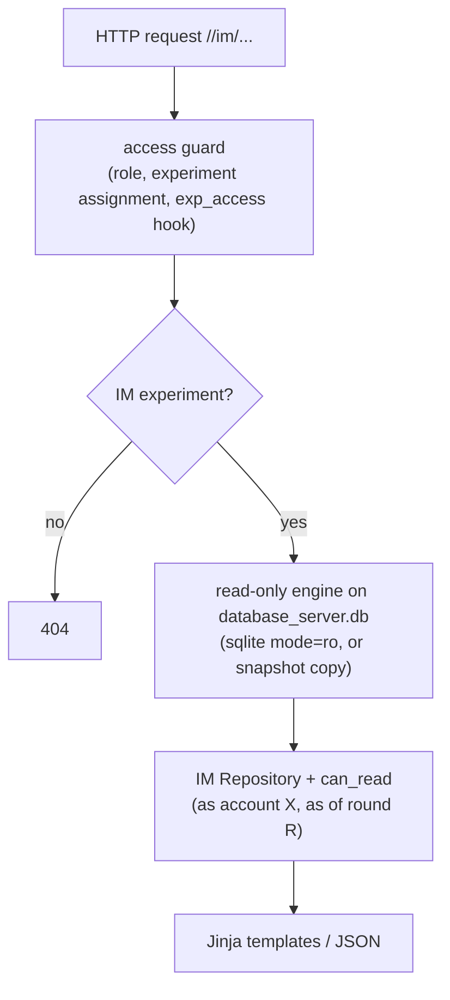
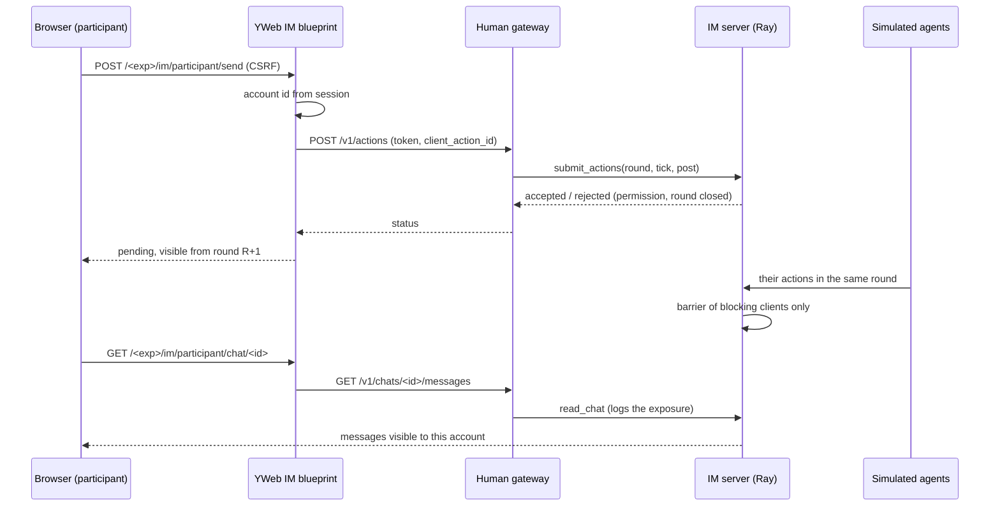
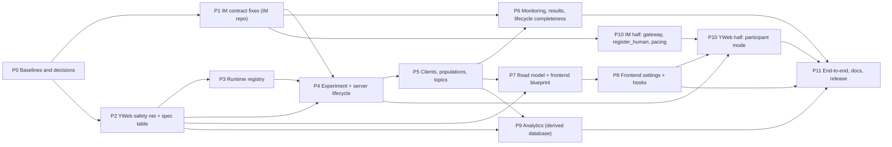

# YInstantMessaging integration into YWeb: technical and implementation plan

| | |
| --- | --- |
| Status | Plan only. No application code, branch or commit was produced by this analysis. |
| Date | 2026-10-25 |
| Revision | 2 (2026-10-25): analytics pages for IM experiments and full human interaction (read and write) are now in scope; DEC-09 and DEC-10 are revised, DEC-17 to DEC-21 are added, Phases 9 and 10 are new or rewritten and the release moves to Phase 11 |
| Author | Claude (analysis requested by Giulio Rossetti, CNR) |
| Baselines analysed | YWeb `main` @ `11c02b15` (local `main` is 1 commit behind `origin/main`), YInstantMessaging `implementation/p0-p14` @ `7f7ce06` (98+ commits, not merged to its `main`), `plugin-registry` `main` @ `92d3669` |
| Audience | A coding agent that will implement the integration, and the maintainers who review it |
| Location | `docs/proposals/im-integration-plan.md` (proposals are not in the MkDocs nav; see 14, decision DEC-12). The repository file and the Claude Doc are the same text |

## How to read this document

Every statement is tagged by how it is known:

- **[E]** Evidence: read in code or docs of the repositories during this analysis. File and line references are as of the baselines above; line numbers drift, so re-check them with `grep` before editing.
- **[P]** Proposal: a design choice made by this plan.
- **[U]** Unverified: could not be confirmed by reading; it is carried into the plan as a verification task (the phase that must settle it is named).

Nothing is presented as available unless it is tagged [E]. "IM" means YInstantMessaging; "YWeb" is the repository root `YSocial` (Flask admin and simulation frontends).

---

## 1. Executive summary and objectives

### 1.1 What is being integrated

IM is a Ray-based simulator of Telegram-like platforms (private chats, groups, channels, forum topics, replies, forwards, reactions, search, roles and permissions, news pages, opinion dynamics, stress/reward, memory, annotations, campaigns). It runs standalone through `run_server.py --config <folder>` and `run_client.py --config <client_config.json>` [E]. It stores everything in its own `database_server.db` (SQLite WAL, or PostgreSQL) and writes JSON-lines logs under `<folder>/logs/` [E]. YWeb integration is explicitly "not implemented" on the IM side (plan section 1.4, 7.6) [E]; YWeb contains no IM code (grep is empty) [E].

### 1.2 Objectives

1. **Admin**: create, configure, validate, start, stop, resume, monitor, clone, reset, delete, export and inspect IM experiments from the existing admin, with the same process management and logging pipeline used for the other Ray platforms.
2. **Frontend**: a dedicated, chat-native user interface (chat list, history, threads, forum topics, members, forwards, reactions, search), not a re-skin of a feed. It has two modes: a read-only **observer** for researchers (running and finished simulations) and **full human participation**, read and write, for human participants (revision 2, DEC-10, DEC-18).
3. **Frontend settings and hooks**: honour every existing frontend setting and plugin hook, with explicit applicability per setting and tests.
4. **Non-regression and standalone**: microblogging, forum, photo sharing and HPC microblogging behave exactly as today; IM keeps working without YWeb.
5. **Analytics** (revision 2): the existing analytics pages (opinion dynamics, stress/reward, toxicity, sentiment, emotions, topics, hashtags, network) are available for IM experiments under the same availability rules as for the other platforms (DEC-09, DEC-17).

### 1.3 Principal findings (what drives the design)

| # | Finding | Consequence |
| --- | --- | --- |
| F1 | IM already follows the YPhotoSharing launch contract: `--config` only, `ray_config.temp` / `ray_namespace.temp` / `ray_ready.temp` markers, `deregister_client`, `<instance>_server.log` and `<instance>_execution.log` [E] | The backend integration is "photo_sharing minus photo specifics", not a new mechanism |
| F2 | YWeb decides "this is a Ray platform" with `simulator_type == "HPC"` and special-cases `photo_sharing` in dozens of places; unknown platforms raise `NotImplementedError` in `hpc/server.py` and `hpc/client.py` [E] | IM must be `platform_type="instant_messaging"`, `simulator_type="HPC"`; a small, behaviour-preserving spec table is proposed instead of adding a third copy of every `if` chain (DEC-03) |
| F3 | The HPC log monitor will mark a cleanly finished IM client as **failed**: it requires the last execution-log line to be `Client shutdown complete` (written only by YSimulator), and reads `logs/{client.name}_execution.log` while IM writes `logs/<folder>:<client>_execution.log` [E] | Blocking contract fix on both sides, with a real end-to-end completion test (DEC-05) |
| F4 | `register_experiment_database` calls `ensure_experiment_schema_for_uri` on `Exps.db_name` (here `.../database_server.db`) at experiment activation, in the opinion pages and in the interview API; it creates YWeb tables and alters existing ones [E] | Without a guard, YWeb would write its schema into IM's database. Hard gate in the first YWeb phase (DEC-04) |
| F5 | IM rotates logs to `*.log.N.gz`; YWeb's `get_rotating_log_files` only knows numeric suffixes, and incremental parsing reads only the main file [E] | Metrics can lose lines at rotation; settle in the monitoring phase (DEC-06) |
| F6 | IM's `read_chat` / `get_feed` are Ray-actor methods that require a registered client and an open round [E]; they are unavailable after the simulation ends | Reading concluded simulations needs direct, read-only database access; reuse IM's own visibility code (`can_read`) instead of re-implementing it (DEC-07) |
| F7 | All of YWeb's DB analytics (opinion, stress/reward, toxicity, sentiment, topics, network, Jupyter `ysights`) are bound to the YSocial schema (`rounds(day,hour)`, `user_mgmt`, `post`, ...); IM has `rounds(day,slot)`, `accounts`, `messages` [E] | Revision 2: these pages must be available for IM under the same rules, on a derived analytics database (1.5, 4.7, DEC-09) |
| F8 | Git: the branch name `im integration` is **not valid** (`git check-ref-format` returns 128); `im-integration` is valid [E]. `external/*` are independent clones (not submodules) and `/external/` is git-ignored in YWeb [E] | One branch per affected repository, named `im-integration` (section 12) |
| F9 | The IM implementation lives on `implementation/p0-p14`; the registry entry points at the repository default branch `main` [E] | Release blocker B1: the IM work must be merged to IM `main` (or the registry branch overridden) before YWeb can install it for users |

### 1.4 Recommended path (summary)

Phase 0 baselines and decisions, Phase 1 IM-side contract fixes, Phase 2 YWeb safety net and the platform spec table, Phase 3 runtime registry, Phase 4 experiment creation and server lifecycle, Phase 5 clients, populations and topics, Phase 6 monitoring, results and lifecycle completeness, then the frontend (Phase 7 read model and blueprint, Phase 8 settings and hooks), Phase 9 analytics for IM experiments (derived analytics database), Phase 10 human participation (IM human gateway, then the participant mode), Phase 11 end-to-end, documentation and release. Phases 6, 7 and 8 can run in parallel after Phase 5 (Phase 7 can start earlier against fixture runs); the IM-side half of Phase 10 can start as soon as Phase 1 is done. Details in section 9.

### 1.5 Revision 2: scope additions

Two requirements were added after the first version of this plan: (a) every existing analytics page must be available for IM experiments under the same rules as for the other platforms; (b) human participants must have full interaction in the IM frontend, including writing. Both reverse revision 1 (DEC-09 gated the analytics off; DEC-10 deferred human participation and made v1 an observer).

| # | Finding | Consequence |
| --- | --- | --- |
| F7 (revised) | YWeb's analytics read raw SQLite tables of the YSocial shape (`rounds(day,hour)`, `user_mgmt`, `post`, `post_sentiment`, `post_toxicity`, `agent_opinion`, `stress_reward`, ...). Photo sharing is already adapted without a branch per page: `_analytics_content_schema` detects the schema and `_resolve_analytics_db_path` points the pages at the platform's own database [E] | IM's database cannot be changed by YWeb (DEC-04), so the pages run unchanged on a **derived, YWeb-owned analytics database** in the YSocial shape, built read-only from IM's database (4.7, DEC-09, DEC-17) |
| F10 | IM has no way for a human to act: `submit_actions` accepts only registered clients, in an open round and a valid tick; rounds advance on a barrier of all active clients; nothing creates a `human` account at run time; reads that log exposures (`read_chat`, `get_feed`, `get_chats`, `search`, `get_notifications`) also need a registered client [E]. The services already accept `kind="human"` and `origin="human"` [E] | Full human interaction needs a small IM component, a **human gateway** (a non-blocking client process with a loopback API) plus a run-time human-account operation; YWeb never writes IM's database (4.8, DEC-18, DEC-19, DEC-21) |
| F11 | A simulation runs much faster than a person can act: the 7-day pilot took 21 to 25 minutes with a real model and about 40 s per 2 days with the echo backend [E] | Humans need an opt-in pacing control for rounds, off by default so standalone and batch runs are unchanged (DEC-20) |

The observer of sections 6.1 to 6.7 stays the researchers' tool; the participant mode (6.8) is added next to it. The release moves from Phase 9 to Phase 11.

---

## 2. AS-IS analysis

### 2.1 Repositories and responsibilities [E]

| Repository | Role | Git state at analysis |
| --- | --- | --- |
| `YSocial` (YWeb) | Flask admin, participant frontends, process management, plugin manager | `main`, behind origin by 1; untracked `scripts/packaging/close_changelogs.py`, `gh_setup_repos.sh` (not ours) |
| `external/YInstantMessaging` | IM runtime and tooling | independent clone, branch `implementation/p0-p14`, origin `YSocialTwin/YInstantMessaging`, remote has only `main` |
| `external/YPhotoSharing`, `YSimulator` | Reference Ray runtimes (closest analogues) | independent clones on `main`; read-only for us |
| `external/YClient`, `YServer`, `YClientReddit`, `YServerReddit` | Standard runtimes | not touched |
| `external/y_memory_subsystem` | Agent memory library; YWeb adds its `src` to `PYTHONPATH` of every launched process (`build_subprocess_env`) | not touched |
| `plugin-registry` | Source of truth of `builtin.json`; separate clone hidden by `.git/info/exclude` | `main` @ `92d3669` |
| `external/frontend_adds-on`, `reactive_agents`, `ScenarioDesign`, `TrainingModules`, `y_agents_plugins` | Suites (frontend/backend/agent plugins) | not touched; consumers of hooks and settings |

`external/` is git-ignored in YWeb (only `external/README.md` and `external/plugins.json` are tracked), so YWeb tests that need a runtime carry the `external_repo` marker and CI does not have the runtimes [E].

### 2.2 How YWeb integrates a platform today [E]

**Experiment model.** `Exps` (`y_web/src/models/admin.py:107`) carries `platform_type` (String(50), default `microblogging`) and `simulator_type` (`Standard` or `HPC`). Photo sharing is `platform_type="photo_sharing"`, `simulator_type="HPC"`. There is no column for platform configuration; it lives in JSON files in the experiment folder. `Client` and `Client_Execution` (`terminal_state`: running, manual_stop, paused, completed, failed) record clients and progress.

**Creation** (`routes/admin/sub/experiments/_crud.py`, `create_experiment` ~L1964): availability check per platform (`_external_repo_availability`, ~L136), platform and simulator forced per platform, port suggestion (`get_suggested_port`, allocated even for Ray runtimes where it is only a placeholder), database handling (HPC and photo get no pre-created database; the server creates it on first start), config generation (`generate_hpc_config`, `generate_photo_sharing_config`, `generate_standard_config`), `Exps`, `Exp_stats`, `Rounds`, topics and a `Jupyter_instances` row.

**Process management.** `src/simulation/execution_backend.py` routes by `uses_hpc_backend(exp)` (`simulator_type == "HPC"`) to `src/hpc/server.py::start_hpc_server` and `src/hpc/client.py::start_hpc_client`. Server: `[python, <repo>/run_server.py, --config, <experiment folder>]` through `ray_safe_cmd` (paths with spaces are aliased), environment from `build_subprocess_env()` (`RAY_AUTH_MODE=disabled` unless set, model cache, `YSOCIAL_HOME`, `PYTHONPATH` with the memory plugin). Client: for photo `run_client.py --config <client json>`; for YSimulator also `--agents` and `--prompts`. PIDs are kept in `Exps.server_pid` and `Client.pid`; process identity is checked by command line (`run_server.py`, `run_client.py`). Stop: client deregistration through the orchestrator actor (hard-coded actor names per platform), then SIGTERM, then SIGKILL after 5 s. App shutdown and start-up cleanup are generic.

**Monitoring.** `LogSyncScheduler` runs `monitor_hpc_client_execution_logs` every `HpcMonitorSettings.check_interval_seconds` for experiments with `simulator_type="HPC"` and `running=1`: it updates progress from the last hourly summary of `<client>_client.log` (24 slots per day, 1-based `slot`), looks for fatal markers and completion markers in the tail of `logs/{client.name}_execution.log`, marks dead PIDs as failed, and stops the server when all clients are completed. Server request metrics come from `logs/_server.log`.

**Frontends.** `main` blueprint (`routes/social/`): `microblogging.py`, `forum.py`, `photo.py` (3.5k lines, raw `sqlite3` on `yphotosharing.db`, its own schema), `common.py`. All participant routes carry `<int:exp_id>`; `setup_experiment_context` (a `before_request`) swaps the shared `db_exp` bind for that experiment. Participants are `Admin_users` rows; `ensure_experiment_user` creates the experiment-side `User_mgmt` row. Settings are per experiment in `exp_frontend_settings` (admin DB).

**Plugins.** Runtimes are a closed list (`builtin_plugins.json`, a generated copy of `plugin-registry/builtin.json`) plus the public registry; backend/frontend suites use `meta/registry.json` and the hook table of `plugin_hooks.py`.

### 2.3 What IM implements, and what it does not [E unless noted]

**Entry points and exit codes.** `run_server.py --config <dir> [--exit-on-complete]`; `run_client.py --config <folder or client json>` (no `--agents`, no `--prompts`: passing them is an argparse error). Exit codes: 0 ok or orderly SIGTERM, 1 unexpected, 2 invalid config or missing plugin, 3 server unreachable, 4 database error or newer schema, 5 too many failed LLM sessions, 6 `config_mismatch` on resume, 130 SIGINT. Before a non-zero exit an ERROR record with `error_type`, `exit_code` and traceback is logged.

**Ray.** `ray.init(address="auto", namespace=...)`, falling back to a local cluster; namespace `<namespace>_<sha256(resolved config folder)[:10]>`; the orchestrator is an actor named `server_name` (default `orchestrator_server`); the client waits for `ray_ready.temp` (default 180 s) and shares a detached LLM actor per namespace.

**Configuration.** Schemas in `schemas/config/*.json`; neither the server nor the client schema sets `additionalProperties: false` and `required` is absent, so extra keys written by YWeb (`platform_type`, `database_uri`, `data_path`, `is_remote`, `experiment_name`) are tolerated. Constraints that matter: SQLite file name is forced to `database_server.db`; PostgreSQL requires `database.postgresql.{host,database,user}` (YWeb's generators write `username`); client `server_name` and `namespace` must equal the server's (the YWeb photo normalizer already rewrites them); the config hash covers `server_config.json`, `client_config.json`, `agent_population.json`, `network.csv`, `telegram_topology.json`, `topic_catalog.json`, `events.jsonl`, `campaigns.json` by literal name, so a mismatch on resume gives exit 6, and a population file named `<pop>.json` is **not** covered.

**Inputs.** Population in the YSimulator format (`{"agents": [...]}` or a bare list; `id` and `username` mandatory); `network.csv` without header, `source,destination` where the source follows the destination (confirmed by the project owner on 2026-10-25, decision P4-03); `telegram_topology.json` (given or generated deterministically); `topic_catalog.json` (derived from `simulation.discussion_topics` if missing); `news_snapshot.jsonl`; optional `events.jsonl`, `campaigns.json`; prompts `prompts_im.json` / `prompts_im.it.json` (packaged, overridable in the run folder; language resolution order documented in IM P7-02).

**Outputs.** `database_server.db` (schema v5), `logs/` (`_server.log`; `<server_name>_server.log`; `<client_id>_execution.log`, `_client.log`, `_actor.log`, `_llm_usage.log`, `_actions.log`, `_prompts.log` off by default), `<client config>.state.json`, `annotation_report.json`, `ray_*.temp`, exports and reports from `yim-export` / `yim-analyze`. `client_id` defaults to `<folder>:<client_name>`.

**Run model.** 24 rounds per day (fixed), each divided into `ticks_per_round` ticks (default 12); resume replays the round in progress from tick 0, idempotent through `client_action_id`; the database is the source of truth; SIGTERM stops cleanly.

**Dependencies.** Core requirements (ray, sqlalchemy>=2, jsonschema, numpy, requests, feedparser) are all within YWeb's lock (ray 2.58, SQLAlchemy 2.0.52, numpy 2.2.6, ...) [E for the ranges; U for a real `pip` resolution, settled in Phase 3]. Extras: `postgres` (psycopg3, distinct from YWeb's psycopg2), `annotations` (torch, detoxify), `analysis` (scipy, sklearn, pandas, pyarrow, sentence-transformers).

**Feature switches (schema defaults are authoritative; some docs say otherwise).** Off by default: stress/reward, memory, annotations, opinion dynamics, campaigns, forum topics, emergent topics, chat creation by agents, churn, new agents, edits, moderation, discovery. **On by default**: private chats, search, forwarding, reactive sessions, and the four agent actions (forwarding, search, private message, forum topics). The server and client switches must agree (`features` of `get_feed`).

**Implemented vs not supported.** Not supported by design: secret chats, calls, voice chats, live streams, stories, stickers, payments, mini apps, bot API, interactive polls, scheduled/silent messages, gigagroups, verification, real media (metadata only), calibration on real Telegram data. Present in the data model but without a frontend: `human` accounts and `messages.origin = human`. The memory context is not yet appended to prompts by the client (IM P9-08). A real-model pilot with `qwen3:4b-instruct` (Ollama, 12 accounts) ran for 1, 2 and 7 days. The 7-day run (`runs/qwen3-4b-instruct_7d/pilot_results.json`, 2026-10-25) completed 168 rounds in both variants with exit code 0 and every LLM call `ok` (off: 430 calls, 1265 s, 260 messages; campaign: 498 calls, 1503 s, 356 messages) [E]. It is a 12-account, single-run smoke test of the run path, not a performance or scale result; it is summarised in `docs/pilot-report.md` (commit `c8d9f75`, not pushed).

**What exists for humans [E].** The schema accepts `accounts.kind = 'human'` and `messages.origin = 'human'`; `MessageService._origin_of` returns `human` for such accounts; IM's analysis treats `human` messages as organic; `search` is documented as "for analysis and for human accounts" (P13-05). Not present: a way to create a human account while a run is live, a client that is exempt from the barriers, any HTTP surface, pacing of rounds.

### 2.4 Architectural and functional differences from the social platforms

| Aspect | Microblogging / forum / photo | IM |
| --- | --- | --- |
| Content unit | `Post` / photo, readable by every participant | `Message` inside a `Chat`; **read access depends on chat type and membership** (`can_read`, rounds, bans) |
| Structure | Feed, hashtags, follow graph | Private chats, groups, channels with linked discussion groups, forum topics, invite links, roles (owner, admin, member, subscriber, restricted, banned, left) |
| Interactions | Like, dislike, share, comment, follow | Reply, **forward** (chains, `fwd_*` origin), reactions restricted by `allowed_reactions`, edit, delete, search, membership actions |
| Time | Round = hour; 24 slots | Round = hour (`(day-1)*24+slot` ordinal) **plus ticks** inside the round |
| Data store | Shared YSocial schema in `db_exp` (microblogging, forum) or the platform's own ORM models (photo) | Own schema (`accounts`, `chats`, `chat_members`, `messages`, `reactions`, `forum_topics`, `read_markers`, `rounds(day,slot)`, ...) in `database_server.db`; PostgreSQL optional |
| Recommenders | Content and follow recsys | None; interests and discovery are IM-internal |
| Server interface | HTTP (standard) or Ray actor (HPC) | Ray actor only; no HTTP surface |
| Identity | `user_mgmt` (UUIDs for HPC) | `accounts` with `kind` in agent, page, campaign, human; unique `username` |

---

## 3. Gap analysis

Severity: **B** blocking (integration cannot work or damages data), **H** high, **M** medium, **L** low. "Owner" is the repository that must change.

| ID | Gap | Evidence | Sev | Owner | Phase |
| --- | --- | --- | --- | --- | --- |
| G01 | No runtime entry in `builtin.json`; group order, `RUNTIME_TEXTS`, `_external_repo_availability` and the group filter of `_runtime_group_active_experiments` do not know IM | `registry.py:~226`, `_crud.py:136-175`, `_external_runtimes.py:98-118` | H | YWeb, plugin-registry | 3 |
| G02 | `NotImplementedError` for unknown platforms in `start_hpc_server`, `start_hpc_client`; hard-coded actor names in `stop_hpc_client`; `reset_client` raises for unknown platforms | `hpc/server.py:231-235`, `hpc/client.py:659-672, 914-931`, `_execution.py:140` | B | YWeb | 2, 4 |
| G03 | **YWeb would write its schema into IM's DB** (activation, opinion pages, interview API) | `context.py:32-66`, `_opinion.py:2612,2918`, `api/interview/_server.py:439` | B | YWeb | 2 |
| G04 | **Completion/failure detection**: IM never writes `Client shutdown complete`; execution log name mismatch (`<folder>:<client>_execution.log` vs `{client.name}_execution.log`); a cleanly exited client with `terminal_state="running"` is marked failed | `log_metrics.py:537, 1339-1341, 1405-1435`; `YInstantMessaging common/logging.py:101` | B | YIM + YWeb | 1, 6 |
| G05 | Progress completion only set inside `parse_client_log_incremental`, called by UI pages, not by the background monitor | `log_parser.py:~637-760`, `_data.py:404-441` | H | YWeb | 6 |
| G06 | gzip-rotated logs (`.log.N.gz`) ignored; lines in a rotated-but-unparsed file are lost | `log_parser.py:779-818`, `log_metrics.py:306-386` | M | YWeb (or YIM) | 6 |
| G07 | PostgreSQL key `username` (YWeb) vs `user` (IM); SQLite filename `yphotosharing.db`/`simulation.db` vs forced `database_server.db`; `psycopg` (v3) not in YWeb requirements | `database.py:~52-60`, `_crud.py:1833, 1928` | H | YWeb (generator), YIM (alias) | 1, 4 |
| G08 | Client launch contract: IM's `run_client.py` rejects `--agents/--prompts`; needs a config normalizer like `_normalize_photo_sharing_client_config`; client config must live beside `server_config.json` | `run_client.py:31-34`, `hpc/client.py:152-180, 698-757` | H | YWeb | 4, 5 |
| G09 | Config hash covers canonical file names only; YWeb names the population `<pop>.json` | `common/config.py:23-42` | M | YIM | 1 |
| G10 | Population/agent payload, topic catalog, network and news inputs not generated for IM; no prompt pack mapping (`prompts_im.json`); `prompts.json` assumptions | `_crud.py:3140-3380`, `prompt_packs`, IM plan 7.6 | H | YWeb | 5 |
| G11 | Reset and clone: reset deletes only `database_server.db`/`simulation.db` (not `-wal`/`-shm`, not `*.state.json`, not `reports/`), log clearing treats `.jsonl` as logs (would delete `news_snapshot.jsonl`); clone copies `-wal`/`-shm`; clone writes `server.port` into HPC config that has top-level `port` | `_data.py:1503-1517`, `_helpers.py:250-288`, `_crud.py:5241-5330, 5428-5470` | H | YWeb | 6 |
| G12 | `Exp_stats` is not updated live; dashboards would show zeros; no YIM-aware progress details | `_data.py` | M | YWeb | 6 |
| G13 | DB-bound analytics pages and Jupyter template assume the YSocial schema | `_opinion.py:~1028, 3097-3260, 7540-8100`, `sample_notebook` | H | YWeb | 9 (revision 2: pages available for IM, not gated) |
| G14 | No `platform_type` support in settings, population typing, UI context, i18n blueprint set, role gate, redirects | `_frontend_settings.py:35-80`, `agents/platform.py:6-8`, `routes/social/helpers.py:861`, `i18n.py:45`, `role_gate.py:141`, `common.py:288-293,1101-1106,1503-1508`, `_crud.py:707-711` | H | YWeb | 7, 8 |
| G15 | No chat-native frontend, no read model, no membership-aware read access outside IM | `routes/social/*` | H | YWeb | 7 |
| G16 | Duplicated frontend settings defaults (`DEFAULT_SETTINGS` and `_UI_DEFAULTS`); `interactions_enabled`, `annotation_sentiment`, `annotation_toxicity` have no consumer | `_frontend_settings.py:127-172`, `routes/social/helpers.py:~700-730` | M | YWeb | 8 |
| G17 | Experiment upload/import and `upload_database` are Standard-oriented; platform detection of imported HPC zips by `server_config.json` | `_crud.py:820-1240, 1661` | M | YWeb | 6 |
| G18 | Docs drift: hooks `staff_experiment_access` and `experiment_page_widget` are implemented but not in `external-runtime-management.md` | `plugin_hooks.py`, docs | L | YWeb | 11 |
| G19 | Contract test in IM re-implements YWeb rules; it does not exercise YWeb's monitor (`check_hpc_client_execution_completion`, `monitor_hpc_client_execution_logs`, `resolve_hpc_client_log_path`) | `test_yweb_log_contract.py` | H | YIM + YWeb | 1, 6 |
| G20 | Release: registry points at IM `main`; the work is on `implementation/p0-p14` | `builtin.json` | B (release) | YIM | 11 |
| G21 | No derived analytics database for IM: the resolvers know only YSocial-shaped databases and the photo database; IM's own database must not be altered (revision 2) | `_opinion.py` (`_resolve_analytics_db_path`, `_resolve_network_analysis_db_path`, `_analytics_content_schema`), DEC-04 | H | YWeb | 9 |
| G22 | IM annotations, topics, hashtags, reactions and opinions live in IM tables (`annotations` + `annotation_methods`, `message_topics`, `message_hashtags`, `reactions`, `agent_opinions`) that the pages do not read; the exact columns each page selects are not yet listed (revision 2) | IM `server/db/models.py`; the page builders | H | YWeb | 9 |
| G23 | The opinion route calls `register_experiment_database`, cache invalidation and `_bootstrap_initial_agent_opinions_if_missing`; for IM these must target the derived database or be skipped [U] | `_opinion.py` opinion route | H | YWeb | 9 |
| G24 | IM cannot create a `human` account while a run is live, and has no client that is exempt from the round barrier (`active() = registered − completed − stale`) (revision 2) | `server/orchestrator.py`, `server/coordination/*`, `server/db/models.py` | H | YIM | 10 |
| G25 | No pacing: rounds close as fast as the agents finish, so a person cannot act in time (the 7-day pilot took 21 to 25 minutes with a real model) (revision 2) | pilot report, coordination code | M | YIM | 10 |
| G26 | IM has no HTTP surface; reads that must log exposures need a registered client; YWeb must not write IM's database (revision 2) | `server/orchestrator.py` | H | YIM + YWeb | 10 |
| G27 | YWeb has no mapping from a participant (`User_mgmt` / `User_Experiment`) to an IM account, and no participant session for IM (revision 2) | `ensure_experiment_user`, `experiment_user_provisioned` hook | M | YWeb | 10 |

---

## 4. TO-BE architecture

### 4.1 Principles

1. **Reuse the Ray (HPC) path**; IM is a new `platform_type`, not a new simulator family (DEC-01).
2. **Keep IM-specific code in its own modules** (`y_web/src/im/`, `routes/social/instant_messaging.py`, `templates/im/`, `routes/admin/sub/experiments/_im.py`, `routes/admin/sub/clients/_im.py`), and keep the edits to shared files to the dispatch points listed in section 8.4.
3. **IM's database is never touched by YWeb's schema code** and **never written by YWeb**: every human write goes through IM's own action path (the human gateway, DEC-18), and analytics read a derived, YWeb-owned database (DEC-04, DEC-07, DEC-17).
4. **One source of truth for read rules**: YWeb reads through IM's own repository and visibility code, not a re-implementation (DEC-07).
5. **No new third-party dependency in YWeb** for v1. IM's own requirements are installed by the Plugin Manager with YWeb's constraints (`PIP_CONSTRAINT`), so a conflict is reported rather than resolved silently.
6. **Standalone IM is untouched in behaviour**; every IM-side change is additive or a bug fix with its own test (section 11.7).

### 4.2 Component view



### 4.3 Start-up sequence (server then client)



### 4.4 Read path of the frontend



### 4.5 Data and identifiers

- **Experiment**: `Exps.platform_type = "instant_messaging"`, `Exps.simulator_type = "HPC"`, `Exps.db_name = experiments/<uid>/database_server.db` (the same string YWeb already stores for every platform, and the name IM forces) [P].
- **Folder** `y_web/experiments/<uid>/`: `server_config.json`, `client_<client>-<population>.json`, `<population>.json`, `network.csv` (or `<client>_network.csv` mapped through `network_file`), `topic_catalog.json`, `telegram_topology.json` (optional), `news_snapshot.jsonl` (optional), `prompts_im.json` / `prompts_im.<lang>.json` copied from the pack, `database_server.db` (+ `-wal`, `-shm`), `logs/`, `*.state.json`, `ray_*.temp`.
- **Identifiers**: IM account ids stay IM's (population ids, usually UUIDs); chats are `c-<uuid5>`; messages and sessions are `uuid5`. YWeb never rewrites them. In the frontend an IM account is addressed by its IM `accounts.id`; there is no `User_mgmt` row for IM agents. (A viewer identity is a YWeb session attribute, not an account; see 6.3.)
- **Time**: progress unit is the round (hour); 24 slots per day, `slot` 1-based in client summaries, `hour` 0-23 in server request logs, `rounds(day, slot)` in IM's DB. All conversion lives in one helper (`y_web/src/im/timeline.py`): `ordinal = (day-1)*24 + slot`.

### 4.6 Is a new abstraction needed? (DEC-03)

The current code expresses "which Ray platform" as `if platform_type == "photo_sharing" ... elif ... else raise` in about ten places of `hpc/server.py`, `hpc/client.py` and `_crud.py`/`_execution.py`. Adding IM as a third branch everywhere is possible but doubles the maintenance of identical decisions. The proposal is a **small, internal spec table** `y_web/src/hpc/platforms.py`:

```python
@dataclass(frozen=True)
class HpcPlatform:
    key: str                      # "microblogging" | "photo_sharing" | "instant_messaging"
    repo_dir: str                 # "YSimulator" | "YPhotoSharing" | "YInstantMessaging"
    runtime_key: str              # builtin_plugins key used by runtime_installed_and_visible
    server_script: str            # "run_server.py"
    client_cmd: Callable[..., list]       # builds the client command line
    normalize_client_config: Optional[Callable]
    orchestrator_actor: str       # "Orchestrator" | "orchestrator_server"
    client_actor: Callable[[str, str], str]
    prompts_file: Callable[[str], str]    # by language
    db_filename: str              # "simulation.db" | "yphotosharing.db" | "database_server.db"
    uses_gunicorn_for_postgres: bool
```

Photo and microblogging entries reproduce **exactly** today's literals (characterization tests first, section 11.3); IM is the third entry. This is the only refactor of shared code proposed; its scope is `hpc/server.py`, `hpc/client.py`, `_hpc_prompts_filename`, `reset_client` prompt cleanup and `reset_hpc_experiment` DB list. Risk and rollback in 13. If the maintainers prefer zero refactor, the fallback is the third `elif` in each place (same behaviour, more duplication): the phase gate for Phase 2 allows either (DEC-03 states the preference, not an obligation).

### 4.7 Analytics for IM experiments (revision 2) [P]

**Goal.** Every existing analytics page (opinion dynamics, stress/reward, toxicity, sentiment, emotions, topics, hashtags, network, and the others in `_ANNOTATION_ANALYTICS_REGISTRY`) is available for IM under the same availability rules as for the other platforms: a page is offered when the tables it needs exist and hold data, and it shows the usual "not available" state otherwise [E: the registry works by required-table presence]. No page gets an IM-specific copy.

**Mechanism** (the one already used for photo sharing [E]): `_analytics_content_schema(conn)` detects the schema and `_resolve_analytics_db_path` / `_resolve_network_analysis_db_path` return the database the pages read. For IM they return a **derived analytics database**, `analytics_im.db`, stored in the experiment folder, owned by YWeb, shaped like a YSocial database, and filled from IM's database by an ETL that opens the source read-only (`mode=ro`, or a snapshot copy as in DEC-07). IM never reads it; YWeb never writes IM's database (DEC-04).

**ETL** (`y_web/src/im/analytics_etl.py`, new). Incremental by watermark (`etl_state`: last message id, last round, source mtime, schema versions); idempotent (running twice gives the same rows; an incremental build equals a full rebuild); single-flight lock per experiment; triggered when an analytics page is opened and the source is newer than the watermark, after a client completes, and by a "Refresh analytics data" action in the admin (8.2). Pages show "data as of day D, slot S".

**Source mapping.** The target column lists are frozen in Phase 9 by listing the columns each page builder selects (G22, verification item 9); the table-level mapping is:

| Derived table (YSocial shape) | Built from (IM) | Notes |
| --- | --- | --- |
| `rounds` (`id`, `day`, `hour`) | `rounds` (`day`, `slot`) | `hour` = slot; whether slots are 0- or 1-based is checked in Phase 9 [U]; the pages carry a note that the time unit is a slot |
| `user_mgmt` | `accounts` | Agents and humans both included, with a `kind` flag so the pages can separate them; persona fields (leaning, age, profession, Big Five) where present |
| `post` | `messages` | A message is a post; a reply (`reply_to` / thread) is a comment of its parent; forwards are shares; `origin` kept (organic, campaign, human) (O-11) |
| `post_toxicity`, `post_sentiment`, `post_emotions` | `annotations` joined with `annotation_methods` | Method names are matched to the page's metric; a table is created only when the method has rows, so availability follows the same table-presence rule [U: names to confirm in Phase 9] |
| topic and hashtag link tables | `message_topics` / `topics`, `message_hashtags` / `hashtags` | Same rule: present only when populated |
| likes / reactions tables | `reactions` | Positive and negative emojis follow IM's `allowed_reactions` classification |
| `agent_opinion` | `agent_opinions` | Same shape in practice; the opinion page also needs `experiment.annotations` to contain `opinions`, which YWeb sets from the IM config at creation (5.2) |
| `stress_reward` | `stress_reward` | Same columns as YSimulator [E] |
| network edges | replies, mentions, forwards, reactions, shared membership (`mentions`, `chat_members`) | Which interactions define an edge is open (O-13); the network page needs `rounds` and `user_mgmt` [E] |

**Side effects.** The opinion route calls `register_experiment_database`, `_invalidate_stale_opinion_evolution_cache` and `_bootstrap_initial_agent_opinions_if_missing` [E]. For IM these target the derived database only, or are skipped (G23, DEC-04); because the derived database is YWeb-owned, YWeb's own schema code may act on it, which is verified in Phase 9 [U] (verification item 10).

**What is not claimed.** The pages do not become statistically comparable to YSocial runs: `slot` is not an hour, a chat message is not a feed post, and there is no recommender system in IM, so the recsys page stays unavailable by the normal rule (O-14). These differences are shown in a short note on each page for IM experiments.

**Tests.** Parity of counts (messages, reactions, annotations, opinions) between IM's database and the derived one; idempotence and incremental equals full; one availability test per page in the style of `test_photo_sharing_analytics.py` [E]; IM database byte-identical after every analytics path; the analytics suites of the other platforms unchanged.

### 4.8 Human participation architecture (revision 2) [P]

**Problem.** A person must read and write in a running IM simulation, as one more participant, without YWeb writing IM's database and without stalling the simulation (G24 to G27).

**Components.**

- **Human gateway** (IM repository, new process, one per experiment): registers with the orchestrator as a client that is **non-blocking** (the round barrier ignores it), keeps the current round and tick, and turns each human action into `submit_actions` with a `client_action_id` for idempotency. It exposes a small HTTP API bound to the loopback interface, protected by a per-run token.
- **`register_human`** (IM server, new operation): creates, idempotently, an `accounts` row with `kind="human"` for a participant while the run is live. The account id is deterministic, `h-<uuid5(exp_uid:admin_user_id)>` (DEC-19), so a participant who reconnects, or a resumed run, finds the same account.
- **Pacing** (IM server, optional key `min_round_seconds`, default 0): a round is not closed before that many seconds have passed, so a person has a window to act. It is a minimum duration, never a wait for humans (DEC-20).
- **YWeb participant mode** (`routes/social/instant_messaging.py`, `src/im/gateway_client.py`, `src/im/human_identity.py`): the participant routes call the gateway; the account is derived from the session, never from the request.



**Reads for humans** go through the gateway (`get_chats`, `read_chat`, `get_feed`, `search`, `get_notifications`), so that IM enforces permissions and logs what the person saw as an exposure, like an agent's [E: these calls need a registered client]. The read-only observer (section 6) stays the tool for researchers and for concluded simulations (DEC-21).

**When the simulation is not running.** Participants see the conversations read-only through the observer path; writing is disabled with an explanation (no direct writes, ever).

**Properties.** If the gateway stops, the simulation continues and the participant sees a clear "connection lost" state; a restart re-registers and replays pending actions safely through idempotency. Human messages carry `origin="human"` and are flagged in exports and in the derived analytics (4.7). Runs with humans are marked non-reproducible in the experiment metadata (R18). Ethics and the information given to participants are the researcher's responsibility (O-12).

---

## 5. Admin integration specification

### 5.1 Reuse / extend / new

| Component (file) | Verdict | Notes |
| --- | --- | --- |
| `Exps`, `Client`, `Client_Execution`, `Exp_stats`, schedule tables | **Reuse as is** | No migration; `platform_type` is `String(50)` [E]. Client rows use the generic columns (the IM-specific values live in the JSON config) |
| `execution_backend.py` routing, `process_registry`, `cleanup_*_from_db`, `stop_all_exps`, `ray_safe_cmd`, `build_subprocess_env` | **Reuse as is** | Entry scripts are `run_server.py`/`run_client.py`, so process identity checks already match [E] |
| `LogSyncScheduler` / `monitor_hpc_client_execution_logs` | **Extend** | Execution-log resolver, IM completion rules, IM failure reason (DEC-05) |
| `hpc/server.py::start_hpc_server`, `hpc/client.py::start_hpc_client` / `stop_hpc_client` | **Extend** (through the spec table) | No gunicorn for IM; client command `--config <client json>` only |
| `_crud.py::create_experiment`, `_external_repo_availability`, `join_experiment`, `change_active_experiment` | **Extend** | New platform option, availability key, join redirect, activation without schema mutation |
| `registry.py`, `_external_runtimes.py` | **Extend** | Group, texts, active-experiment filter |
| `settings.html` (platform select), `dashboard.html` badge, `experiment_details*.html` | **Extend** | New option and badge; new `experiment_details_im.html` variant |
| `clients_*.html`, `clients/_crud.py::create_hpc_client` | **New** (modelled on `clients_photo`) | `clients_im.html`, `clients/_im.py`: IM client form, config generator, population mapper |
| `populations.py`, `agents/platform.py` | **Extend** | `instant_messaging` population type; reuse HPC population generation (YSimulator format) |
| Topic management (`Topic_List`, `Exp_Topic`, `Page_Topic`) | **Extend** | Export to `topic_catalog.json`; association topic to channels/groups editor is the only genuinely new admin UI (IM plan 7.6) |
| `reset_hpc_experiment`, `copy_experiment`, `_delete_simulation_internal`, `clear_experiment_log_files` | **Extend** | Sidecars, state files, reports, `.jsonl` protection (G11) |
| Opinion / stress-reward / annotation / topic / network analytics pages, Jupyter template | **Extend** (resolver and ETL; no page copy) | Offered under the same availability rules; the resolvers point at the derived `analytics_im.db` (4.7, DEC-09, DEC-17); Phase 9 |
| Participant identity and IM participant mode (human account, gateway, participant routes) | **New** | `src/im/human_identity.py`, `src/im/gateway_client.py`, participant routes and templates; IM side: gateway, `register_human`, pacing (4.8, DEC-18 to DEC-21); Phase 10 |
| Admin notification and error presentation | **Reuse** | Use the existing compact top-right overlay cards; no new layout, per the standing admin-UI requirement |

### 5.2 Experiment creation and configuration

**Form** (`settings.html`, handled by `create_experiment`): new platform option "Instant messaging" (disabled with an explanatory message when the runtime is missing or not visible, like photo). Fields reused: name, description, group, language of the prompts, topics (`tags`), LLM agents enabled. Fields **not shown** for IM: Redis box, perspective/sentiment/emotion/opinion annotation toggles, remote host/port (remote is out of scope in v1; the existing HPC remote path is itself incomplete [E], DEC-15), PostgreSQL (v1 supports SQLite only; DEC-14).

**Server config generator** `generate_im_server_config(...)` in `routes/admin/sub/experiments/_im.py`, writing `server_config.json`:

| Key | Value | Evidence / rule |
| --- | --- | --- |
| `server_name` | `orchestrator_server` | IM default; actor name used by `stop_hpc_client` |
| `namespace` | `yinstantmessaging` (IM appends the config-folder hash) | IM default; do not copy YPhotoSharing's literal |
| `min_to_start` | 1 | as photo |
| `timeout_seconds`, `ready_timeout_seconds` | 180 | YWeb waits up to 180 s for `ray_ready.temp` |
| `database` | `{"type": "sqlite"}` (no `filename`, or exactly `database_server.db`) | IM forces the name, other names give exit 2 |
| `simulation.num_days`, `simulation.start_date` | from the form (default start date today) | |
| `telegram.time.ticks_per_round` | 12 (default) | |
| `telegram.*` feature switches | IM defaults, overridable in the "Features" section of the form | server and client must agree |
| `logging` | IM defaults plus `enable_server_log: true` | `_server.log` is needed by the log metrics |
| `platform_type` | `"instant_messaging"` | tolerated by the schema; used by upload/import and copy |
| `is_remote`, `experiment_name`, `database_uri`, `data_path` | as the photo generator writes them | tolerated extras |

**Validation** (two layers): (1) form-side validation of types and ranges in the generator (clear flash messages); (2) authoritative validation by IM itself: `yim-validate --config <folder> --json` is executed before the first start of the server and before each client start (no Ray, no writes, exit 0 or 2) [E]. A non-zero exit blocks the start and shows the JSON errors in the compact error card. The documented IM schemas under `schemas/config/*.json` (and `scripts/config_descriptions.py`) feed an "Advanced" section; see 5.3.

**Prompts.** Copy the pack's `prompts_im.json` (and the language variant) into the folder at creation (as `prompts_ygram.json` is for photo), and record the language with `prompt_packs.record_language`. Adding the file to `data_schema/prompts/<lang>/` is part of Phase 5; IM resolves `prompt_language` from the client config first, so the order matches YWeb's `prompt_language.json` [E, IM P7-02].

### 5.3 Clients, agents and population

`clients_im.html` + `create_im_client` (modelled on `create_hpc_client` and the photo branch):

- **Identity and duration**: `name`, `descr`, `population_id`, `days` (`num_days`), `infinite_duration` not supported in v1 (IM runs a fixed number of rounds) [E: `total_rounds = num_days * 24`].
- **LLM**: `backend` (`ollama`, `vllm`, `openai`, `echo`; `echo` is offered as "dry run (no model)" and is the default for smoke tests), `model`, `address`, `port`, `temperature`, `max_tokens`, `max_concurrency`, `timeout_seconds`, `max_failed_session_ratio`, `failure_window_sessions`, `failure_min_sessions`. API keys: only through `llm_api_key_env` (never written to disk in plaintext by YWeb), consistent with IM's own warning.
- **Agent dynamics** (each section collapsed, off by default where IM is off): churn, new agents, memory, stress/reward (with the five affective traits), opinion dynamics (`bounded_confidence` | `llm_evaluation`), annotations, forum topics, emergent topics, chat creation, discovery, moderation, campaigns file (path only), news (feed sources reuse YWeb's RSS resources).
- **Telegram structure**: topology file (upload or "generate"), `topic_catalog.json` (from the experiment topics), `actions_likelihood`, `scheduling`, `attention`, `reactive`, `agent_actions` switches.
- **Advanced**: a schema-driven JSON editor over `schemas/config/client_config.json` (read from the installed IM repo at render time so the form never drifts from the installed version), validated with `jsonschema` (already a YWeb dependency [U, confirm in Phase 5]) and then by `yim-validate`.

**Population.** Reuse the HPC population generation (YSimulator document `{"agents":[...]}`, `id` and `username` mandatory, optional fields as IM reads them: `leaning, user_type, age, language, profession, activity_profile, archetype, cluster, llm, toxicity, daily_activity_level, round_actions, is_page, feed_url, interests, Big Five (oe, co, ex, ag, ne), custom_features, stubborn_topics, affective_traits`) [E]. Mapper `_apply_im_agent_fields` mirrors `_apply_photo_sharing_agent_fields`: maps YWeb custom features and Big Five to IM keys, writes pages as `is_page: 1` with `feed_url`, and leaves unknown fields in place (IM keeps them in `extra`). Duplicate ids/usernames are rejected by IM (ConfigError), so YWeb checks them first.

**Client config normalizer** `_normalize_im_client_config` (spec table entry): sets `client_id` (`<folder>:<client>`), `namespace` and `server_name` copied from `server_config.json`, `address: "auto"`, `agents_file` = population file name, `network_file`, `logging.log_dir` = `logs`, `logging.instance_name`; it never writes secrets; and it is idempotent (re-run before every start, as `hpc/client.py` already does for photo). The client config file name stays `client_<client>-<population>.json` and sits beside `server_config.json` (IM reads the markers from the config's folder [E]).

**Start/stop/resume/restart.** Through the unchanged backend routes. Resume is "start again"; YWeb already restarts clients whose `elapsed_time < expected_duration_rounds` [E]. IM's resume requires the **same config hash**: YWeb must not rewrite hashed files between runs (the normalizer only touches keys excluded from the hash, as photo's does [E, `EXCLUDED_KEYS`]); a changed population or topic file is a deliberate "new run" (Reset). Exit code 6 is mapped to the message "configuration changed since the run started; reset the experiment or restore the original files".

### 5.4 Lifecycle, errors, partial execution

| Event | Detection | Admin behaviour |
| --- | --- | --- |
| Normal completion | Last execution-log line `Client shutdown complete` after `Client natural completion reached` (YIM change, DEC-05), or `elapsed >= expected` | `terminal_state="completed"`; when all clients completed, stop server and set `exp_status="completed"` |
| Manual stop / pause | Existing routes set `terminal_state` before stopping | unchanged |
| Crash or kill | PID dead with `terminal_state="running"` | `failed`; **new**: surface the last `level: ERROR` record of the client execution log (`error_type`, `exit_code`) in the compact error card |
| Exit 2/4/5/6 | Same | Message per code: invalid config, database error or newer schema, too many failed LLM sessions, config mismatch on resume |
| Server crash | server PID dead while experiment `running=1` | existing HPC handling; schedule group restart logic unchanged |
| Partial execution | `Client_Execution.elapsed_time` from the last hourly summary | progress bar as today; resume continues from IM's state file and database |
| LLM backend down | exit 5 (`TooManyLLMFailuresError`) after the rolling-window rule | message names the LLM host and model |

Stop is bounded: YWeb sends SIGTERM and waits 5 s before killing the process tree; IM documents a clean stop in under 4 s [E]. The Phase 4 end-to-end tests must measure the real value under load (risk R05).

### 5.5 Results, persistence, data access (admin)

- **Download** (existing, zip of the folder): for IM, create a consistent copy of the database first with SQLite's online backup API (`sqlite3 ... .backup`), so a download of a running experiment never captures an inconsistent DB/WAL pair (G11 follow-up), and exclude `-wal`/`-shm`.
- **Exports**: a new "Export data" button in `experiment_details_im.html` that runs `yim-export --config <folder> --format parquet|csv [--snapshot]` as a background job and offers the files under `<folder>/exports/`. `pandas`/`pyarrow` live in IM's optional `analysis` extra; the button is disabled with a hint when they are not installed.
- **Analysis reports**: `yim-analyze` commands (`activity`, `cascades`, `network`, `homogeneity`, `emergence`, `stress-reward`, ...) write `<folder>/reports/<command>_report.json`; a read-only "Reports" panel lists and renders them as tables (no charts in v1). Optional dependencies as above.
- **Persistence**: nothing new in the admin database. Progress and state come from `Client_Execution` and the files; `Exp_stats` is filled by a small IM adapter (rounds from the client summary, agents/messages/reactions from IM's `run_info`/counts through the read model) so dashboards do not show zeros (G12, Phase 6).
- **Analytics** (revision 2): all the existing analytics pages are offered for IM under the same availability rules as for the other platforms, from the derived database (4.7, 5.7): opinion evolution, stress/reward evolution, annotation analytics (toxicity, sentiment, emotions), topic/hashtag evolution, network analysis, experiment matrix annotation columns. Where the data does not exist (for example the recommender page) the usual unavailable state is shown, never a 500. The Jupyter sample notebook folder is still created; an IM sample notebook that reads `analytics_im.db` (or the `yim-export` tables) is optional in Phase 9.
- **Schedule groups**: IM experiments follow the HPC rules (cannot be mixed with Standard; counted in `max_hpc_per_group`) [E].

### 5.6 Clone, reset, delete, upload

| Operation | Required handling |
| --- | --- |
| Clone (`copy_experiment`) | Copy configs and inputs; skip `logs/`, `*.state.json`, `ray_*.temp`, `database_server.db`, `-wal`, `-shm`, `reports/`, `exports/`; fix the HPC port key bug (top-level `port`); copy `is_remote` |
| Reset (`reset_hpc_experiment`) | Delete DB **and sidecars**, `*.state.json`, `reports/`, `exports/`; clear logs without touching `*.jsonl` inputs (`news_snapshot.jsonl`, `events.jsonl`) |
| Delete | Existing generic code (folder removal); no PostgreSQL branch needed in v1 |
| Upload/import | Detect IM by `platform_type == "instant_messaging"` in `server_config.json`; v1 imports a **finished or reset** experiment only, validated with `yim-validate`; other cases flash an explicit "not supported" |

### 5.7 Analytics availability (admin) [P]

- Menus and links for the analytics pages follow the **same availability function** as for other platforms; for IM it is evaluated on `analytics_im.db`. The page is not removed for IM by platform name.
- The experiment page shows "Analytics data: as of day D, slot S" with a **Refresh analytics data** action (`POST /admin/im/analytics/<exp_id>/refresh`) and the ETL status (never run, running, failed with message).
- `Exps.annotations` is set from the IM configuration at creation (for example `opinions` when opinion dynamics is enabled), so the opinion page's existing test passes without a new rule. The YSocial annotation toggles of the form (perspective, sentiment, emotion) stay hidden: IM's own configuration decides which annotations exist.
- Failure states: ETL failed, source locked, source newer schema version → a message in the compact notification card and the pages show their normal empty state.

### 5.8 Human participation (admin) [P]

- Experiment form, section "Human participation" (default **off**): enable, pacing `min_round_seconds`, maximum number of humans, allow chat creation (maps to the `human.*` keys of 8.7). Enabling is part of the hashed configuration (a different run).
- Participants are assigned with the existing experiment assignment (`User_Experiment`); no new admin table. The experiment page lists the humans (YWeb user, IM account id, online, last action) and the gateway status (running, last heartbeat, queue length).
- Start order: IM server → human gateway → IM clients (the gateway must be registered before the first round opens); stop order is the reverse. A gateway failure is shown as a warning and never marks the simulation failed.
- Optional **participant notice**: free text set by the researcher in the experiment form and shown before a participant's first entry. The platform imposes no ethics gate; the researcher informs participants of the experimental details (O-12).
- Export and download keep working; human rows are flagged (`kind`, `origin`).

---

## 6. Frontend specification (YInstantMessaging)

### 6.1 Scope of version 1 and what is **not** claimed

IM has no participant frontend and no HTTP interface of its own [E]. The IM frontend has **two modes** (revision 2): the **observer** (researchers, concluded simulations, any viewpoint and time), described in 6.2 to 6.7, and the **participant mode** (6.8), in which a human takes part as one more account, with full interaction: reading and writing. Humans never write to the database directly: every write goes through the human gateway and IM's own action handlers (4.8, DEC-10, DEC-18). Version 1 of the frontend therefore includes both.

### 6.2 Pages and routes

New blueprint module `routes/social/instant_messaging.py` registered on the `main` blueprint package (like `photo.py`), all routes with `<int:exp_id>` so `setup_experiment_context` and `experiment_access_guard` apply; IM routes **must not** call `experiment_db_bind` (see 4.1). Templates in `templates/im/`.

| Route | Content |
| --- | --- |
| `GET /<exp>/im` | Entry: viewpoint picker and chat list |
| `GET /<exp>/im/chats` | Chat list for the viewpoint: type icon (private, group, channel, discussion group, forum), title, last message preview, member count, unread count from `read_markers` (when viewing as an account) |
| `GET /<exp>/im/chat/<chat_id>` | History, newest at the bottom, paged upwards with `before=<message id>` cursor; message bubbles with sender (name, kind badge), simulated timestamp, reply preview, forwarded-from banner (origin chat and sender, chain depth), reactions (counts per emoji), edited/deleted markers (deleted shown as a tombstone for researchers) |
| `GET /<exp>/im/chat/<chat_id>/topic/<topic_id>` | Forum topic view; a tab strip lists topics (`forum_topics`, including deleted ones flagged for researchers) |
| `GET /<exp>/im/chat/<chat_id>/members` | Member list with roles and permissions summary (owner, admin, member, subscriber, restricted, banned, left), join rounds |
| `GET /<exp>/im/thread/<message_id>` | Thread (`thread_root_id`) and discussion-group comments for channel posts (`discussion_root_of`) |
| `GET /<exp>/im/search?q=` | Search over the readable messages of the viewpoint (the same rules as IM's FR-21 search: visible chats only) |
| `GET /<exp>/im/profile/<account_id>` | Account profile: kind, username, persona fields (age, profession, leaning, Big Five, interests) with the same researcher-only gating as other platforms for sensitive persona data, memberships |
| `GET /<exp>/im/api/...` | JSON for paging, polling (`/api/status?after=<cursor>`: current day/slot, new-message counts per chat), and the round selector |

**Timeline.** A header control "as of day D, slot S" (default: latest). All queries take the round and use `can_read(..., round_)` and the same `visibility_lag_ticks` logic as `history`, so the observer can replay a concluded simulation hour by hour. Auto-refresh by polling every N seconds only while the experiment is running and the selector is on "latest".

### 6.3 Viewpoints, identities and permissions

| Viewpoint | Who may use it | Semantics |
| --- | --- | --- |
| **As account X** | admin, researcher | Exactly what account X could read at round R (IM's `can_read`); shows unread counters |
| **Public observer** | all roles allowed into the experiment | Only chats with public visibility and not banned; no private chats, no DMs |
| **Researcher overview** | admin, researcher (never participants) | All chats including private ones, with a persistent banner "omniscient view" so exports and screenshots are not mistaken for a participant's view |
| **As human participant** | participants assigned to the experiment with human participation on | Exactly what the participant's own account can read at the current round (IM's `can_read` through the gateway), with write access subject to IM's permission service; the account is fixed by the session (6.8) |

Role handling reuses the existing machinery: experiment assignment (`User_Experiment`) at login, the `experiment_access_guard` hook, `teacher_gate`/`REHEARSAL_PATHS` for teachers (the IM entry path must be added), and `PARTICIPANT_ROLES`. A participant who selects an IM experiment lands on the participant mode when human participation is on for it and the person has an IM account, and on the public-observer view otherwise (`join_experiment` and `select_experiment` redirect branches). No `User_mgmt` row is required for observing; `ensure_experiment_user` still runs in the existing flow, which is harmless because IM's database is not YWeb's bind (4.1), but the redirect must not depend on the per-user feed URL. Identity of the IM agents is never exposed as a login.

### 6.4 Media, attachments, profiles

IM stores no real media; messages may carry URLs with metadata (`message_urls`) and `kind`/media metadata only [E]. v1 renders URLs as link cards from stored metadata (no fetching) and media as typed placeholders. Avatars come from the existing `get_safe_profile_pic` seeded by username; no upload.

### 6.5 Sync with the simulation state

The observer reads a live WAL database: readers do not block the writer, and IM sets `busy_timeout=5000` [E]. Each request opens a short read-only connection; the status endpoint reads `run_info`/`rounds` only. When the experiment is not running and the server is down, the same code reads the file (it must still find the `-wal` beside the main file after a crash, so the folder must stay writable for `-shm` creation; if `mode=ro` fails for that reason the adapter falls back to a **snapshot copy** made with the online backup API and cached by file mtime, DEC-07).

### 6.6 Look and feel, i18n

Own base template `templates/im/base.html` (not the 2000-line monolith pattern of photo): header with experiment name, viewpoint and time selectors, language switcher (`shared/language_switcher.html`), `shared/plugin_loader.html` for frontend suites, light/dark theme using the same CSS variables as the microblogging header toggle, responsive two-pane layout (chat list and conversation; single pane on narrow screens). Static assets `static/assets/css/im.css`, `static/assets/js/im-chat.js` (no new vendor library). All strings through `gettext`; the IM blueprint/endpoint names must be added to `SIMULATION_BLUEPRINTS` in `i18n.py` (otherwise the admin language logic would apply to participant pages) and the catalogs updated (`messages.pot`, `it`, `en_US_POSIX`; CI checks coverage at 98%). User-generated message text never goes through the catalogs (existing rule, test `test_user_generated_text_never_goes_through_the_catalogs`).

### 6.7 Frontend settings and hooks (summary; full matrix in section 7)

IM applies the display settings that make sense for a chat (`show_post_time`, `posts_per_page`, `infinite_scroll_enabled`, `language`, `language_switch_allowed`, `annotation_agent_type`, `annotation_author_type`), honours the interaction switches (`interaction_post/comment/like/share`) and `notifications_menu` in the participant mode (revision 2: they govern real controls and are enforced on the server), and excludes the recommender, filter-bubble, forum-feed-type and photo-tab settings by capability. In the observer there is nothing to hide for the interaction switches. New IM-specific keys are proposed in 7.3.

### 6.8 Participant mode: full human interaction [P]

**Identity.** The IM account of a participant is created on first entry through `register_human` (4.8) with the deterministic id of DEC-19 and a display name from the YWeb profile (pseudonymised unless the researcher decides otherwise, O-12). The session fixes the account; no request parameter can name another account.

**Actions.** Every action maps to an existing IM handler [E: the handlers exist for agents]; IM's `PermissionService` decides, so the interface offers what the account may do and the server refuses the rest.

| Action in the UI | IM action | Notes |
| --- | --- | --- |
| Send a message (chat, channel where allowed, forum topic) | `post` | Idempotent with `client_action_id`; length limit; `interaction_post` enforced on the server |
| Reply (including thread and discussion-group comment) | `reply` | `interaction_comment` |
| Forward | `forward` | `interaction_share`; the forwarded-from banner is the same as the observer's |
| React / remove reaction | `react` | `interaction_like`; emojis from the chat's `allowed_reactions` |
| Edit and delete own message | `edit`, `delete` | Within IM's rules for authors and roles |
| Join and leave a chat, join by invite link, create an invite link | `join`, `leave`, `create_invite_link` | Invite links respect IM's expiry and limits |
| Create a chat, create or delete a forum topic | `create_chat`, `create_forum_topic`, `delete_forum_topic` | Subject to the `human.allow_create_chat` key and to the account's role |
| Moderation (ban, restrict) | `ban`, `restrict` | Only if the account holds the role in that chat; otherwise refused by IM |
| Mark as read | `read` | Updates `read_markers` and the unread counters |
| Open chats, history, search, notifications | `get_chats`, `read_chat`, `search`, `get_notifications` | Read through the gateway so that the exposure is logged |

**Time and feedback.** The header shows the simulated day and slot and a round progress hint. A sent message is shown as **pending** and becomes visible to others according to IM's visibility lag (from the next tick or round); a message refused by permissions, a closed round or the gateway shows the reason and can be retried safely. Updates arrive by polling (and optionally long polling) of the gateway; the interval is a setting (7.3).

**Safety.** CSRF on every state-changing request; account taken from the session; per-run token between YWeb and the gateway and loopback only; an allowlist of actions; message text escaped on output and never trusted as HTML; rate limit and size limit per participant; no private chat of other accounts is ever readable; optional notice screen before the first entry, with text defined by the researcher (O-12).

**Failure handling.** Gateway down or restarted: the page shows "connection lost" and retries; pending actions are resubmitted with the same `client_action_id`. Simulation finished or paused: writing disabled, history stays readable. Participant removed from the experiment: the session guard blocks the routes (`experiment_access_guard`).

---

## 7. Hook and frontend-settings mapping

### 7.1 Where settings live and how they are applied today [E]

- Storage: table `exp_frontend_settings` (bind `db_admin`; `exp_id`, `settings_json`, `updated_at`), one JSON blob per experiment merged over defaults at read time; no migration is needed for new keys (`src/models/admin.py:905-925`).
- Admin page `/admin/frontend_settings` (`_frontend_settings.py`): only keys of `DEFAULT_SETTINGS` are accepted and coerced by the type of the default; `SUPPORTED_PLATFORMS` filters the experiments listed and the API answers 404 for others; applicability per platform is the static table `PLATFORM_CAPABILITIES` (`None` = everything, microblogging) with `MICROBLOGGING_EXCLUDED_CAPABILITIES` hiding forum/photo-only keys.
- Frontend side: `_load_ui_settings` and `_UI_DEFAULTS` in `routes/social/helpers.py` (the defaults are **duplicated** with `DEFAULT_SETTINGS`); `_platform_ui_context()` injects `ui`, `platform_ui`, `forum_show_*` and `frontend_adds_on_modules` only for `forum` and `photo_sharing`; `shared/platform_ui_gating.html` hides controls with CSS (`display:none !important`) for those two platforms, while microblogging templates gate markup directly.
- Plugin suites: per-experiment, per-module state in `FrontendAddsOnExpModuleSettings`; the generic panel filters a module's parameters by their own `platforms` list (a module without `platforms` is microblogging-only).

### 7.2 Traceability matrix: frontend setting → expected IM behaviour → component → test

Legend for the verdict: **Honour** (works and is tested in v1), **Register** (key accepted and stored, no control to gate in v1, behaviour tested through the template contract so it activates with the participant mode of Phase 10), **Exclude** (not offered for IM through `PLATFORM_CAPABILITIES`), **Wire** (key exists but has no consumer today; do not claim it works).

| Key (default) | Today (consumer) | Verdict for IM | Expected IM behaviour | Component to touch | Verification test (new unless noted) |
| --- | --- | --- | --- | --- | --- |
| `interaction_post` (true) | MB `feed.html`; F/P via gating CSS | Honour | Governs the composer (send message) in participant mode; when off the composer is hidden and the participant route answers 403, so the setting is enforced on the server and not only by CSS. No effect in the observer | `templates/im/*` (`data-im-compose`), `shared/platform_ui_gating.html`, participant routes | Template contract plus route test: POST with the setting off → 403 |
| `interaction_comment` (true) | MB posts; F/P gating | Honour | Reply action on a message bubble (`data-im-reply`); off: hidden and the reply route answers 403 | same | same |
| `interaction_like` (true) | MB posts; F/P gating | Honour | Reaction picker; IM reactions are emojis from `allowed_reactions`; off: hidden and the reaction route answers 403 | same | same |
| `interaction_dislike` (true) | MB posts; capability F only | Exclude | IM has no downvote; negative emojis are ordinary reactions governed by the chat | `PLATFORM_CAPABILITIES` | `test_platform_only_controls_are_not_offered_*` extended to IM |
| `interaction_share` (true) | MB posts; P gating | Honour | Forward action on a bubble (`data-im-forward`); off: hidden and the forward route answers 403 | same | same |
| `interactions_enabled` (true) | defined only, no consumer | Wire | Master switch: implemented for IM from the start (hides all `data-im-*` action markers); do not document as working for other platforms | `templates/im/base.html`, gating | Template test; a separate ticket for the other platforms is **out of scope** |
| `notifications_menu` (true) | MB header; F gating | Honour | Participant mode: the header shows the notification centre fed by `get_notifications` (mentions, replies, invites); observer: no bell. Off hides it in both modes | `templates/im/header` | Header test: bell present in participant mode only when on, never in the observer |
| `annotations_enabled`, `annotation_emotions`, `annotation_topics` (true) | MB, F chips | Exclude | IM annotations (`annotations` table: language, sentiment, toxicity, topics) are not shown in v1; the "Reports" panel of the admin covers analysis | capabilities | `test_platform_only_controls_*` |
| `annotation_sentiment`, `annotation_toxicity` (true) | defined only | Exclude | not offered | capabilities | same |
| `annotation_agent_type` (true) | MB posts; P badge | Honour | Shows the `accounts.kind` badge (agent, page, campaign, human) on sender names | `templates/im/components/message.html` | Render test with `kind` values |
| `annotation_author_type` (true) | MB posts | Honour | Same badge for the author of forwarded/quoted originals | same | Render test |
| `show_post_time` (true) | MB posts; F/P gating | Honour | Shows the simulated timestamp "Day D, HH:00 (tick T)" on bubbles; off hides it, never the ordering | message component, gating | `test_gating_hides_only_switched_off_controls` extended with the IM marker `data-im-time` |
| `show_trending_hashtags` (true) | MB feed/hashtag/thread | Exclude (v1) | IM has `hashtags` and `message_hashtags`, but no hashtag feed in v1 | capabilities | capability test |
| `show_suggested_friends` (true) | MB, P | Exclude | No suggestions in the observer | capabilities | capability test |
| `show_recsys_info` (false), `default_content_recsys`, `default_follow_recsys` | recsys boxes, user creation | Exclude | IM has no recommender | capabilities | capability test |
| `show_annotation_stats` (false) | side boxes; needs module `post_annotation` | Exclude | module not ported | capabilities | capability test |
| `language` (""), `language_switch_allowed` (false) | `i18n.py:resolve_experiment_language`; cookie `ys_lang_sim` | Honour | The IM pages use the simulation catalog (blueprint in `SIMULATION_BLUEPRINTS`), fixed language when set, switcher when allowed | `i18n.py`, `templates/im/base.html` | `test_i18n_experiment_language.py::test_simulation_pages_load_the_simulation_catalog` extended with an IM request |
| `profile_topics_box` (true) | MB/F profile | Honour (profile) | Shows the interest/topic box on the IM profile page when on | `templates/im/profile.html` | Render test |
| `onboarding_enabled` (true) | `common.py:1095-1098`; redirect per platform | Honour | An IM experiment has no onboarding page: the onboarding redirect branch for `instant_messaging` goes straight to the IM entry whatever the value; the key must not cause a redirect loop | `routes/social/common.py` (3 redirect sites), `_crud.py:707-711` | Route test: select/join an IM experiment lands on `/<exp>/im` |
| `infinite_scroll_enabled` (true) | MB feed | Honour | Upward infinite scroll of the history; off shows "Older messages" pagination links | `im-chat.js`, template | Render test of both modes |
| `posts_per_page` (10) | MB, F (clamped 1-100), P | Honour | Page size of the history (messages per page, clamped 1-100 like forum) and of the chat list | `instant_messaging.py` | Unit test of the clamp; route test of page size |
| `default_forum_feed_type`, `default_photo_feed_tab` | F, P | Exclude | not applicable | capabilities | `test_platform_specific_defaults_are_saved_and_validated` extended |
| `filter_bubble_*` (8 keys) | `content_recsys.py` ranking | Exclude | not applicable | capabilities | capability test |

**Proposed IM-only keys** (added to `DEFAULT_SETTINGS`, `_UI_DEFAULTS` **and** the IM capability list in the same commit; a test fails if the two default tables differ, which also removes the existing duplication risk, G16):

| Key | Default | Meaning |
| --- | --- | --- |
| `im_show_forward_origin` | true | Show the forwarded-from banner and chain depth |
| `im_show_reactions` | true | Show reaction counts |
| `im_show_member_roles` | true | Show roles in member lists and next to sender names in groups |
| `im_default_view` | `latest` (`latest` or `start`) | Initial time position of the observer |
| `im_allow_time_travel` | true | Show the "as of" selector to non-researchers |
| `im_public_observer_enabled` | true | Allow participants to enter the public-observer view |
| `im_participant_mode_enabled` | true | Offer the participant mode to assigned participants when the experiment has human participation on |
| `im_participant_poll_seconds` | 3 | Polling interval of the participant mode (clamped by the server) |

Each proposed key needs: entry in `PLATFORM_CAPABILITIES["instant_messaging"]`, a control in `frontend_settings.html`, the template gate, and a test (save/load/coercion + render).

### 7.3 Hook matrix

Each row follows the five steps requested: position and contract today, applicability, how the IM frontend respects it, adaptation, test.

| Hook / contract | Position and contract today [E] | Applicable to IM? | How IM respects it | Adaptation required | Test |
| --- | --- | --- | --- | --- | --- |
| `post_login(admin_user) -> url or None` | `routes/auth/routes.py:100`; participant roles only; only `/...` local redirects accepted | Yes, unchanged | An IM experiment does not change the login flow; plugin hooks keep working | none | Existing hook tests plus: a hook redirect still wins before the IM experiment selector |
| `experiment_access_guard(account_id, exp_id) -> None / url / response` | `context.py:210-234`; every request with `exp_id` when the session has `platform_account_id` | Yes | IM routes are under `<int:exp_id>`, so the guard runs; the participant routes also check that the session's account is the human account of this experiment | participant routes (Phase 10); the guard stays the extension point for membership-based gating | Route test: a guard that returns a redirect blocks `/<exp>/im`; a participant cannot act as another account |
| `experiment_user_provisioned(exp, account_id, exp_user_id, created)` | `ensure_experiment_user`, only when `account_id` is passed | Yes | Emitted by the existing login flow; with human participation on, the IM account is created idempotently (`register_human`, DEC-19) at first participant entry, not at login of other roles | `src/im/human_identity.py` (Phase 10) | Existing provisioning tests; add: selecting an IM experiment emits it once and the account is created once (replay safe) |
| `staff_experiment_access(user, exp_id)` | `role_gate.py:152-157`; teacher rehearsal | Yes | Teachers entering an IM experiment pass the gate through `REHEARSAL_PATHS` | add the IM entry path (`/im`) to `REHEARSAL_PATHS` (`role_gate.py:141`) | Role-gate test: teacher denied by default, allowed on the IM path when the hook returns True |
| `experiment_page_widget(account_id, exp_id) -> html` | Only `microblogging/header.html` includes it (`backend_plugins.py:928-934`) | Yes | `templates/im/header.html` includes the same helper so a plugin widget (for example TrainingModules) appears on IM pages | include in the IM header | Template contract test: widget HTML present in the IM header for a participant, absent for staff |
| `schema_module: migrate(engine_admin)` | Backend suite startup/install; runs on the **admin** engine | Yes | Unaffected | none | Existing |
| `permissions` | Validated, no consumer | N/A | none | none | none |
| Backend suite `sidebar` | admin menu | N/A (admin only) | none | none | existing |
| `i18n: {domain, translations}` | `plugin_i18n.py` | Yes | The IM header's plugin strings use the same domains | none | existing |
| Frontend suite module `platforms` | `frontend_plugins.py`, generic panel; module absent from a platform returns 409 on save | Yes: modules opt in | `post_annotation` and `responsive_agents` do **not** list `instant_messaging` and therefore do not appear for IM experiments; this is intended in v1 | none in YWeb; documented | `test_manifest_for_platform_drops_scoped_parameters_and_empty_sections` extended: an IM experiment lists no modules |
| `visibility_filter` (module manifest) | `get_hidden_user_ids`, consumed by `src/data_access/posts.py:299` | Not consumed | IM visibility is decided by IM's own code in both modes (6.3, 6.8); the hook is not applied | none | none |
| `platform_event_handler` | `dispatch_platform_event`, called only from `photo.py:2008` | Not consumed | IM v1 emits no platform events | none | `test_dispatch_platform_event_is_inert_without_suites` still passes |
| `shared/plugin_loader.html` | Included by MB, F, photo bases | Yes | IM base includes it; `active_modules_context(exp_id)` returns `[]` for IM today | verify `platform` value handling in `active_modules_context` for an unknown platform (must return `[]`, not raise) | `test_plugin_loader_included_in_*_templates` extended to IM |
| `platform_ui_gating.html` | CSS gate for F and P | Yes | Included in IM base | add `instant_messaging` to `_platform_ui_context` accepted platforms (`helpers.py:861`) | existing gating tests extended |
| `SIMULATION_BLUEPRINTS`, `teacher_gate` open prefixes | `i18n.py:45`, `role_gate.py` | Yes | IM routes must be treated as simulation pages | add the IM endpoints to the set; no change to the open prefixes | i18n and role-gate tests |

**Docs drift to fix in Phase 11**: `docs/reference/external-runtime-management.md` ("Backend plugin extension points") documents three hooks, the code has five (G18).

---

## 8. API, data contracts and models

### 8.1 Existing endpoints and services reused

| Existing | Use for IM |
| --- | --- |
| `/admin/create_experiment`, `/admin/start_experiment`, `/admin/stop_experiment`, `/admin/delete_simulation`, copy/upload/download, schedule | Same URLs; IM branches inside |
| Client routes `run_client`, `resume_client`, `pause_client`, `stop_client`, `reset_client`, `extend_simulation` | Same URLs; IM branches in `reset_client` (state file, sidecars) and `extend_simulation` (see below) |
| `/admin/external_runtimes` | Install/validate/delete IM like other runtimes |
| `LogSyncScheduler` and the metrics tables (`ServerLogMetrics`, `ClientLogMetrics`, `LogFileOffset`) | Same, with the resolver and rules of DEC-05 |
| `/api/interview/*`, `/api/social/*`, `/api/reddit/*` | **Not used**; the interview API assumes `user_mgmt` and `database_server.db` YSocial schema (`_memory.py:112-114`) and must refuse IM experiments with a clear 4xx (guard, Phase 2) |

**`extend_simulation`** (adding days to a running or finished client): IM fixes `num_days` in the client config and resumes by replaying from the state file. Extending is feasible only by editing `simulation.num_days` before a restart, which changes the config hash and gives exit 6. v1: **not supported for IM** (button hidden, message explains); revisit with a deliberate IM feature (decision DEC-16).

### 8.2 New endpoints

All under existing blueprints and role checks; no new top-level blueprint other than the frontend module.

| Endpoint | Method | Role | Purpose |
| --- | --- | --- | --- |
| `/admin/im/validate/<exp_id>` | POST | admin, researcher | Run `yim-validate --json` and return the structured errors (also used by the client form) |
| `/admin/im/exports/<exp_id>` | POST / GET | admin, researcher | Start an export job / list produced files |
| `/admin/im/reports/<exp_id>` | GET | admin, researcher | List and render `reports/*.json` |
| `/admin/im/topics/<exp_id>` | GET / POST | admin, researcher | Association topic → channels/groups (feeds `topic_catalog.json`) |
| `/<exp_id>/im/...` | GET | per 6.3 | The observer frontend of section 6 |
| `/<exp_id>/im/participant/...` | GET / POST | participant assigned to the experiment, human participation on | Participant mode: composer, actions, polling (6.8); POST needs CSRF and uses the session's account |
| `/admin/im/analytics/<exp_id>/refresh` | POST | admin, researcher | Run the ETL now and report its watermark (4.7) |
| `/admin/im/gateway/<exp_id>` | GET | admin, researcher | Gateway status: running, last heartbeat, queue length, humans online (5.8) |

### 8.3 Contracts between YWeb and IM

1. **Process contract** (unchanged, [E]): `run_server.py --config <folder>`, `run_client.py --config <client json>`; markers `ray_config.temp`, `ray_namespace.temp`, `ray_ready.temp` in the config folder; exit codes 0/1/2/3/4/5/6/130.
2. **File contract**: files and keys YWeb must write (5.2, 5.3); keys excluded from the config hash (`client_id`, `namespace`, `server_name`, `address`, `agents_file`, `logging.log_dir`, `logging.instance_name`, `llm_api_key`, `perspective_api_key`) may be rewritten on every start; any other change to a hashed file is a new run.
3. **Log contract** (after DEC-05): `logs/_server.log` JSON per request with `day`, `hour`, `duration`, `path`, `time`; `logs/<client_id>_client.log` JSON with `summary_type` hourly/daily, `day`, `slot` 1-24, `total_execution_time_seconds`, `actions_by_method`; `logs/<client_id>_execution.log` JSON records ending in `Client natural completion reached` then `Client shutdown complete`; fatal records `level: ERROR` with `error_type`, `exit_code`, `traceback`. `client_id` may contain `:` and is resolved with the existing suffix resolver, now also for the execution log.
4. **Data contract**: the database is IM's schema (current `schema_version` 5, `docs/data-dictionary.md`); the read model checks `run_info`/migration version at open and refuses a **newer** version than it knows (clear message), accepts older ones only if the tables it uses exist (IM runs migrations itself on server start).
5. **Versioning**: YWeb records the IM package version it was tested against in a constant (`IM_MIN_SCHEMA_VERSION`, `IM_TESTED_VERSION`); the runtime `meta/info.json` carries `version` (to add, optional key [E]); the registry's `min_ysocial_version` can pin the YWeb side. A mismatch shows a warning on the experiment page, not a hard failure.

### 8.4 Dispatch points to change (files)

The IM plan estimates about 100 `platform_type` dispatch points; after analysis the ones that matter for IM are below. Anything not listed keeps its default (non-IM) branch and must be exercised by the regression tests.

| Area | Files and functions |
| --- | --- |
| Registry | `plugin-registry/builtin.json`; `y_web/src/external_runtime/builtin_plugins.json` (generated); `registry.py` (`grouped_runtime_specs` order, `RUNTIME_TEXTS`); `_external_runtimes.py::_runtime_group_active_experiments`; `y_web/tests/data/builtin_specs_golden.json` |
| Creation and join | `_crud.py`: `_external_repo_availability`, `create_experiment`, `join_experiment` (L707-714), `change_active_experiment` (L720-818), `upload_experiment`, `copy_experiment`, `_hpc_prompts_filename`, `_experiment_prompt_pack`; `templates/admin/settings.html`, `static/assets/js/admin-settings.js` |
| Process | `hpc/server.py::start_hpc_server`, `stop_hpc_server`; `hpc/client.py::start_hpc_client`, `stop_hpc_client`, `_is_hpc_*`; new `hpc/platforms.py` |
| Clients and populations | `clients/_crud.py::clients`, `create_hpc_client_route`, `create_client`, `_get_experiment_mode`; `clients/_execution.py::reset_client`, `extend_simulation`; `agents/platform.py`; `populations.py`; templates `clients_im.html`, `populations.html`; new `clients/_im.py` |
| Monitoring and results | `hpc/log_metrics.py` (resolver, completion, failure reason), `hpc/log_parser.py` (`.gz` rotation); `_data.py` (`experiment_details` template choice, reset, `Exp_stats`); `_opinion.py` resolver (Phase 9); `routes/admin/dashboard.py` badge; `dashboard.html` |
| Analytics (revision 2) | `_opinion.py` (`_analytics_content_schema`, `_resolve_analytics_db_path`, `_resolve_network_analysis_db_path`, opinion route side effects), new `src/im/analytics_etl.py`, availability tests in the style of `test_photo_sharing_analytics.py` |
| Human participation (revision 2) | YWeb: new `src/im/human_identity.py`, `src/im/gateway_client.py`, participant routes and templates, `hpc/platforms.py` (start order, gateway process); IM: new gateway module, `server/orchestrator.py` (`register_human`, non-blocking registration), `server/coordination/*` (pacing) |
| DB safety | `src/experiment/context.py::register_experiment_database`, `setup_experiment_context`; `src/experiment/helpers.py`; `src/experiment/schema.py` callers; `routes/api/interview/_server.py` |
| Frontend | new `routes/social/instant_messaging.py`, `templates/im/`, `static/assets/{css,js}/im*`, `src/im/`; `routes/social/common.py` (redirects at 288-293, 1101-1106, 1503-1508), `routes/social/helpers.py::_platform_ui_context`; `i18n.py::SIMULATION_BLUEPRINTS`; `role_gate.py::REHEARSAL_PATHS` |
| Settings | `_frontend_settings.py` (`SUPPORTED_PLATFORMS`, labels, `PLATFORM_CAPABILITIES`, `DEFAULT_SETTINGS`), `templates/admin/frontend_settings.html`, `routes/social/helpers.py::_UI_DEFAULTS` |
| i18n and prompts | `translations/*`, `data_schema/prompts/<lang>/` (add `prompts_im.json`), `scripts/prompts/*`, `docs/prompt-hashes.json`, `docs/prompt-inventory.md` |
| IM repository | `common/logging.py`, `common/config.py` (hash by `agents_file`), `database.py` (PostgreSQL `username` alias if DEC-14 changes), `meta/info.json` (`version`), contract tests |

### 8.5 Models

No new tables in the admin database in v1 or in revision 2 (the derived analytics database and the gateway state file live in the experiment folder, 8.7). Optional `ExpFrontendSettings` keys (7.3) need no migration. `Exps.platform_type` accepts the new value without a type change [E]. `Population.username_type` gains the value `instant_messaging` (it is a string; the validator `VALID_POPULATION_TYPES` is the only gate).

### 8.6 Errors and compatibility

- IM exit codes mapped to admin messages (5.4).
- The read model raises typed errors (`ImDatabaseMissing`, `ImSchemaTooNew`, `ImNotReadable`) that the routes turn into a compact in-page card, never a 500.
- Compatibility between YWeb and IM versions: see 8.3 item 5; the contract tests of Phase 1 and the YWeb golden tests of Phase 3 fail when either side drifts.

### 8.7 Revision 2 contracts [P]

All names below are proposals; none exists today.

1. **Gateway ↔ YWeb (HTTP, loopback only, JSON).** Header `X-IM-Gateway-Token` (per-run token; only its hash is stored in `human_gateway.json`). `POST /v1/humans/ensure` (idempotent, returns the account id), `GET /v1/state` (day, slot, round open, pacing), `POST /v1/actions` (`client_action_id`, action, arguments; returns accepted, pending or rejected with a reason), `GET /v1/chats`, `GET /v1/chats/<id>/messages?before=`, `GET /v1/search?q=`, `GET /v1/notifications`, `GET /v1/events?after=` (cursor for polling). Errors: 401 token, 403 permission, 409 round closed, 429 rate limit, 503 gateway not ready.
2. **Gateway ↔ IM server.** New: `register_human`, `register_client(..., blocking=False)` (excluded from the barrier set), optional `min_round_seconds`. Everything else is the existing API (`submit_actions`, `read_chat`, `get_feed`, `get_chats`, `search`, `get_notifications`, `create_invite_link`, `heartbeat`, `deregister_client`).
3. **Config keys** (IM server configuration): `human.enabled` (default false, part of the config hash), `human.gateway.host` (loopback), `human.gateway.port`, `human.pace.min_round_seconds` (default 0), `human.max_humans`, `human.allow_create_chat`. Port and token are excluded from the hash like other runtime keys (8.3 item 2).
4. **State file** `human_gateway.json` in the experiment folder: pid, port, token hash, started_at, registered client id. Written by the gateway, read by YWeb; removed on clean stop; included in reset and clone exclusions (5.6).
5. **Account id.** `h-<uuid5(exp_uid:admin_user_id)>` (DEC-19); `accounts.kind = human`; messages `origin = human`.
6. **Analytics database.** File `analytics_im.db` in the experiment folder; YSocial-shaped tables of 4.7 plus `etl_state(last_message_id, last_round, source_mtime, source_schema_version, analytics_schema_version)`; owned by YWeb; excluded from clone and included in reset and in the download only when the user asks for it; never read by IM.
7. **YWeb routes**: 8.2 (admin), 6.8 (participant). No new top-level blueprint.

---

## 9. Incremental implementation plan

### 9.1 Dependency analysis and sequence

The order below is derived from real dependencies, not from a preset template:

- The **IM contract fixes** (Phase 1) and the **YWeb safety net** (Phase 2) have no dependency on each other and run in parallel; both are prerequisites of everything that starts a process.
- The **registry** (Phase 3) is needed before an experiment can be created from the UI (availability check), but not before the safety net.
- **Server lifecycle** (Phase 4) needs registry + spec table + DB guard; **clients** (Phase 5) need the server lifecycle; **monitoring** (Phase 6) needs real client runs and the IM completion marker.
- The **frontend read model** (Phase 7) needs only an IM database, so it can start after Phase 2 against fixture databases built by IM's own tooling; it is integrated with real experiments after Phase 5. **Settings and hooks** (Phase 8) need the Phase 7 templates.
- **Analytics** (Phase 9) writes only to the derived database. It needs the Phase 2 safety net, can start on fixture databases right after Phase 2, and is validated on real runs after Phase 5. It does not depend on the frontend.
- **Human participation** (Phase 10) has two halves: the **IM half** (`register_human`, non-blocking registration, pacing, the gateway) depends only on Phase 1 and can start early in the IM repository; the **YWeb half** (identity, start order, participant routes) needs the Phase 4 start order and the Phase 7 and 8 templates and settings.



Parallelizable: P1 ∥ P2; P6 ∥ P7 (different files, different reviewers); P7 can begin on fixtures right after P2; P9 and the IM half of P10 can run in parallel with P6 to P8 (different files and repositories). Everything else is sequential.

Standing rules for every phase: work on the branch `im-integration` of each affected repository (section 12); run the **smoke set** (11.6) before each commit that touches runtime code; a phase is **done** only when its Go/No-Go gate passes; commit messages follow section 12.3; black and isort for YWeb (the repository's formatter workflow auto-commits otherwise).

---

### Phase 0: Baselines, branches, characterization of today

1. **Objective.** A frozen, reproducible starting point and the decisions that cannot wait for code.
2. **Prerequisites.** Authorisation to create branches (explicit, given by the project owner); access to the three repositories.
3. **Repositories.** YWeb, YInstantMessaging, plugin-registry (read; branches created at the end of the phase).
4. **Components.** None modified.
5. **Activities.**
   1. In YWeb: `git fetch`, fast-forward local `main` to `origin/main` (currently 1 behind), record `git rev-parse HEAD`; leave the two untracked packaging scripts alone (not ours; do not stage them).
   2. In IM: confirm the working tree is clean at `implementation/p0-p14` (7f7ce06 or later) and decide the baseline (DEC-11: branch from `implementation/p0-p14`, because that is where the implemented plan lives; `main` is behind).
   3. In plugin-registry: baseline `92d3669` (`main`).
   4. Run the YWeb test suite on the baseline (`pytest`, excluding the documented CI `--deselect` list) and store the pass/fail list as `docs/proposals/im-integration-baseline.txt` **outside the repository history** (attach to the PR) so later failures can be attributed.
   5. Run IM's suite (`TEST=unit ./scripts/run_local_tests.sh`) and the real-model pilot on the baseline if available.
   6. Resolve the open decisions that block Phase 1/2: DEC-03 (spec table or elif), DEC-05, DEC-06, DEC-13 (hash), DEC-14 (SQLite only), DEC-10 and DEC-18 (observer plus participant mode), DEC-17 (derived analytics database).
   7. Create `im-integration` in the three repositories (only after approval, section 12).
6. **Deliverables.** Baseline record (commit ids, test results), approved decision list, branches.
7. **Tests.** The baseline suites themselves.
8. **Success criteria.** Baseline suites green (or known failures listed); decisions recorded in the PR description.
9. **Go/No-Go.** GO if all three baselines are recorded and the suites' results are reproducible twice. NO-GO if baselines are red without an explanation; corrective action: file the failures as pre-existing and exclude them explicitly, or fix on a separate branch first.
10. **Regression.** n/a (no code).
11. **Commits.** None (branches only). Optional first commit on YWeb: this document (`docs: im integration plan`).
12. **Risks.** Hidden failing tests (R10); stale `main` (mitigated by the fast-forward).
13. **Rollback.** Delete the branches.

---

### Phase 1: IM-side contract fixes (repository: YInstantMessaging)

1. **Objective.** Make IM satisfy YWeb's log, config and metadata contracts without changing its standalone behaviour.
2. **Prerequisites.** Phase 0.
3. **Repositories.** YInstantMessaging only.
4. **Components.** `yinstantmessaging/client/simulation_client.py` (completion records), `common/logging.py`, `common/config.py` (hash), `schemas/config/server_config.json` (if a logging switch is added), `meta/info.json`, `docs/logging.md`, `tests/contract/`.
5. **Activities.**
   1. **Completion marker (DEC-05).** On natural completion the client logs, in this order, `Client natural completion reached`, `Notified server of completion`, `Simulation complete. Server notified.` (already present [E]) and then, as the **last** record of `<client_id>_execution.log`, the record `Client shutdown complete` (the same text YSimulator writes, which YWeb's `check_hpc_client_execution_completion` checks as the last line [E]). Also written on a clean SIGTERM stop (YWeb sets `terminal_state` before stopping, so it ignores it) so the monitor never sees a clean exit without a final record.
   2. **Execution-log file name.** Verify whether `logging.instance_name` controls the file prefix (`exec_name = f"{name}_execution.log"`, `common/logging.py:101` [E]) [U: whether `name` comes from `instance_name` or from `client_id`]. If it does, YWeb's normalizer sets `instance_name = <client name>` and the YWeb monitor needs no resolver change; if it does not, add the option so that it does, and document it (DEC-05).
   3. **Rotation (DEC-06).** Add `logging.compress_rotated` (default `true`, i.e. today's behaviour) so YWeb can run IM with plain `.log.N` files, the only form its parser understands.
   4. **Config hash (DEC-13).** Hash the file named by `agents_file` and `network_file` in addition to the canonical names (backwards compatible for runs that use the canonical names; document the one-time `config_mismatch` that an existing run with a non-canonical population name would get, or gate the new rule by a `hash_version` field so existing run folders keep their old hash).
   5. **Validation contract.** Freeze and document the `yim-validate --json` output (`{"ok": bool, "errors": [{"path","message"}]}` or the real current shape, documented as found) and its exit codes; add a test.
   6. **Metadata.** `meta/info.json`: add `version`; align `group` with the registry entry (verify how `scan_plugin_info_files()` uses `group`, [U]).
   7. **Contract tests.** Add tests that assert: last execution-log record equals the marker after a completed echo run; client summaries contain `summary_type`, `day`, `slot` (1-24); `_server.log` records carry `day`, `hour`, `duration`, `path`, `time`; file names produced with `instance_name`; uncompressed rotation when `compress_rotated=false`; hash behaviour. Where YWeb source is available, extend the existing `ast`-based extraction in `test_yweb_log_contract.py` to run YWeb's `check_hpc_client_execution_completion` on the real log of an echo run (skipped when YWeb is not checked out).
6. **Deliverables.** Commits on IM `im-integration`; updated `docs/logging.md`, `docs/configuration.md`, `CHANGELOG.md`, decisions entries.
7. **Tests.** IM unit, contract, integration and e2e suites; new contract tests above.
8. **Success criteria.** All IM suites green; standalone example run (`scripts/make_example.py` + `run_server.py` + `run_client.py`, echo backend) produces unchanged outputs except the added final record; hash of an unchanged existing run folder is unchanged.
9. **Go/No-Go.** GO if the contract tests pass and the standalone golden e2e (`tests/e2e/test_golden_run.py`) still matches. NO-GO if any golden changes: revert the change that moved it (completion and logging changes must not touch simulation output).
10. **Regression.** IM `unit`, `contract`, `integration`, `e2e` suites in chunks of at most 180 s (`RAY_TMPDIR` short path), CLI help of `yim-*`.
11. **Commits.** `feat(logging): final "Client shutdown complete" record`, `feat(logging): compress_rotated switch`, `fix(config): hash the files named by agents_file and network_file`, `docs(logging): YWeb log contract`, `chore(meta): version in info.json`.
12. **Risks.** Changing the hash breaks resume of old runs (mitigated by `hash_version`); extra final record confuses IM tests that assert the last line.
13. **Rollback.** Revert the individual commits; none alters data formats.

---

### Phase 2: YWeb safety net and the platform spec table

1. **Objective.** Make it impossible for YWeb to damage or mis-handle an IM database, pin down today's Ray-platform behaviour with tests, and introduce the single place where platform differences live.
2. **Prerequisites.** Phase 0.
3. **Repositories.** YWeb.
4. **Components.** `y_web/src/experiment/context.py`, `schema.py` callers, `helpers.py`, `routes/api/interview/_server.py`, `_opinion.py` register calls, `hpc/server.py`, `hpc/client.py`, `_hpc_prompts_filename`, `_execution.py::reset_client`, new `y_web/src/hpc/platforms.py`, new `y_web/src/im/__init__.py` with the constant `IM_PLATFORM = "instant_messaging"` and `is_im_experiment(exp)`.
5. **Activities.**
   1. **Characterization tests first**, before any refactor: for `photo_sharing` and HPC `microblogging`, assert the exact server and client command lines, the environment keys, the actor names used by `stop_hpc_client`, the prompts file names, the DB file lists of `reset_hpc_experiment`, and the output of `_normalize_photo_sharing_client_config` on a fixture config (existing tests `test_hpc_config_compat.py`, `test_hpc_server_pid_lifecycle.py`, `test_phase6_src_hpc.py` are the model).
   2. **DB isolation (DEC-04).** `register_experiment_database`, the Postgres/SQLite `open_experiment_session` path, the interview API and the opinion pages must **skip schema creation and bind registration** for IM experiments (decide by `Exps.platform_type`, not by file contents; additionally refuse any `ensure_experiment_schema_for_uri` call on a SQLite file that contains the IM table `run_info` [U: confirm the IM marker table name against `server/db/models.py`]). The IM read model (Phase 7) never uses `db_exp`.
   3. **Spec table.** Introduce `HpcPlatform` (4.6) with entries for `microblogging` and `photo_sharing` reproducing today's literals; route `start_hpc_server`, `start_hpc_client`, `stop_hpc_client`, `_hpc_prompts_filename`, `reset_client` and the DB file list through it. No behaviour change.
   4. **Fail loudly** for an unknown platform with a message that names the missing spec (replacing bare `NotImplementedError` text).
6. **Deliverables.** Tests, `platforms.py`, guards, `im/__init__.py`.
7. **Tests.** Characterization tests; guard tests with a fixture IM database built by IM's models (or a minimal DDL with `run_info`, `rounds(day, slot)`): after activating the experiment, opening the opinion page, hitting the interview endpoint and creating a session, the file's sha256 and `sqlite_master` are unchanged.
8. **Success criteria.** Characterization tests pass before and after the refactor; guard tests pass; the full existing YWeb suite is green.
9. **Go/No-Go.** GO only if (a) every characterization test is green on the baseline **and** after the refactor, (b) the isolation test proves a byte-identical IM file. NO-GO if any command line or config differs: stop and fix the spec entry (the refactor is reverted wholesale if it cannot be made identical, falling back to the `elif` approach).
10. **Regression.** Full `pytest` of YWeb; manual smoke: create and start a photo experiment and an HPC microblogging experiment through the admin (when their runtimes are installed).
11. **Commits.** `test(hpc): characterize photo and microblogging launch contracts`, `refactor(hpc): platform spec table (no behaviour change)`, `fix(experiment): never apply the YSocial schema to instant messaging databases`.
12. **Risks.** Refactor regression (R03), partial coverage of frozen (PyInstaller) command branches (they must be included in the characterization).
13. **Rollback.** Revert the refactor commit; the isolation commit is independent and safe to keep.

---

### Phase 3: Runtime registry and availability

1. **Objective.** IM appears in `Admin > Plugins`, can be installed/validated/deleted, and experiment creation knows whether it is available.
2. **Prerequisites.** Phase 2 (spec table, constants). Registry write access (open decision O-02).
3. **Repositories.** plugin-registry, YWeb.
4. **Components.** `plugin-registry/builtin.json` (and its schema/CI), `scripts/packaging/sync_builtin_plugins.py` (run, not edited), `y_web/src/external_runtime/builtin_plugins.json` (generated), `registry.py`, `_external_runtimes.py`, `_crud.py::_external_repo_availability`, `y_web/tests/data/builtin_specs_golden.json`, `translations/*`.
5. **Activities.**
   1. Add to `builtin.json` the entry proposed in IM plan 7.6 (key `instant_messaging`, group `instant_messaging`, category `simulation_runtimes`, directory `YInstantMessaging`, repo `YSocialTwin/YInstantMessaging`, branch `main`, install `python -m pip install -r requirements.txt`, entrypoints `run_server.py`, `run_client.py`, `requirements.txt`, `validate_import: yinstantmessaging`, `private: true`, `seed: true`); run the registry's own validator; commit on the registry branch.
   2. In YWeb: `python scripts/packaging/sync_builtin_plugins.py --source <registry checkout>`; add `instant_messaging` to `grouped_runtime_specs` order and `RUNTIME_TEXTS` (marked with `N_()`); extend `_external_repo_availability` with the key `instant_messaging`; extend `_runtime_group_active_experiments` (experiments with `platform_type == "instant_messaging"` block plugin mutation while active).
   3. Update the golden spec file deliberately and the assertions in `test_builtin_plugins_registry.py` / `test_external_runtime_manager.py`.
   4. i18n: update `messages.pot` and the `it`/`en_US_POSIX` catalogs (CI checks).
   5. Verify the dependency install: `PIP_CONSTRAINT` run with IM's `requirements.txt` against the real core constraints [U], with IM's extras excluded.
6. **Deliverables.** Registry commit, generated copy, code and test updates.
7. **Tests.** `sync_builtin_plugins.py --verify` and `--check` (offline); the manager tests; a test with `YSOCIAL_PLUGIN_VISIBILITY` granting the IM key to a user; install simulation against a local IM checkout.
8. **Success criteria.** IM listed with the right group/label; `Validate` passes on the current checkout; install resolves with zero changes to core pins; creation page shows "Instant messaging" disabled when absent.
9. **Go/No-Go.** GO if install, validate and visibility behave like photo. NO-GO if `pip` reports a conflict: negotiate the IM requirement ranges (IM side) rather than loosening the core pins.
10. **Regression.** Golden specs for the other 12 runtimes unchanged; Plugin Manager tests; wheel check (`check_wheel.py`).
11. **Commits.** Registry: `feat: instant_messaging runtime`; YWeb: `feat(runtime): register YInstantMessaging`, `chore(i18n): runtime texts`.
12. **Risks.** B1 (IM `main` lacks the work; during development the local checkout is used and the registry entry is not exercised against GitHub), private-repo visibility (R08).
13. **Rollback.** Revert the YWeb commits and re-run `sync_builtin_plugins.py` against the previous registry commit.

---

### Phase 4: Experiment creation and server lifecycle

1. **Objective.** Create an IM experiment from the admin, start and stop its server, activate it, delete it.
2. **Prerequisites.** Phases 1, 2, 3.
3. **Repositories.** YWeb.
4. **Components.** `routes/admin/sub/experiments/_im.py` (new: generator, validation job), `_crud.py` (create, join, activate, copy dispatch), `settings.html`, `admin-settings.js`, `hpc/platforms.py` (IM entry), `hpc/server.py`.
5. **Activities.**
   1. Add the platform option and availability handling; hide the unsupported fields (5.2).
   2. Implement `generate_im_server_config` (table in 5.2) and write `server_config.json`; do **not** pre-create the database (HPC rule); write `prompts_im*.json` and `prompt_language`.
   3. `create_experiment`: `simulator_type="HPC"`, `Exps.db_name = experiments/<uid>/database_server.db`, topics and `Jupyter_instances` as usual.
   4. IM entry in the spec table (script `run_server.py`, no gunicorn, actor name `orchestrator_server`).
   5. `join_experiment`/`select_experiment` redirect branch to `/<exp>/im` (the page itself arrives in Phase 7; until then a placeholder page states "viewer not available yet").
   6. `yim-validate` hook before server start; map exit 2 to a flash.
   7. Make sure activation (`change_active_experiment`) uses the Phase 2 guard.
6. **Deliverables.** Working create/start/stop/delete of an IM experiment without clients.
7. **Tests.** Unit: generator output against IM's JSON schema (`jsonschema` + `yim-validate`); route tests for create (with and without the runtime), activation, delete; integration: real `run_server.py` started by `start_hpc_server` in a temp experiment folder (marked `external_repo`), assert markers appear, the DB is created with `database_server.db` and has no YWeb tables, stop completes within the allowed time.
8. **Success criteria.** Creating an IM experiment yields the documented files; server starts and stops repeatedly (5 cycles) with no stale markers or PIDs; `Exps.running`/`exp_status` transitions match photo's.
9. **Go/No-Go.** GO if the 5-cycle test is green and the DB-integrity assertion holds. NO-GO if stop takes longer than the 5 s grace and kills the process tree (DB left with a hot WAL): fix IM shutdown time or extend YWeb's grace for IM through the spec entry.
10. **Regression.** Create/start/stop experiments of every other platform (route tests), schedule tests, upload/copy tests unaffected.
11. **Commits.** `feat(im): server config generator`, `feat(im): create experiment option and availability`, `feat(im): server start and stop through the platform spec`.
12. **Risks.** Port allocation collisions (placeholder port), Ray cluster sharing between concurrent experiments (R06).
13. **Rollback.** Revert the commits; created experiments are ordinary folders and can be deleted.

---

### Phase 5: Clients, populations, topics and prompts

1. **Objective.** Configure and run IM clients from the admin through to a completed run.
2. **Prerequisites.** Phase 4.
3. **Repositories.** YWeb; IM only if a defect is found (back to Phase 1 commits).
4. **Components.** `clients/_im.py`, `clients_im.html`, `clients/_crud.py` dispatch, `agents/platform.py`, `populations.py`, `hpc/client.py` (IM entry, normalizer), `data_schema/prompts/<lang>/prompts_im.json` and prompt tooling.
5. **Activities.** As in 5.3: client form (essential + advanced, schema-driven), population mapper and file, topic catalog export and the topic → channels/groups editor, network and topology files, prompt pack, normalizer, validation before start, start/stop/resume wiring, exit-code mapping. Add `instant_messaging` to `VALID_POPULATION_TYPES` and to the population creation UI (reuse the HPC generator; hide photo-only fields).
6. **Deliverables.** A 1-day, echo-backend experiment created, started and completed entirely from the admin.
7. **Tests.** Unit: mapper (fields, duplicates, pages), normalizer (idempotent; hashed keys untouched), catalog export; route tests; integration (`external_repo`): admin API → server + client → completion; `kill -9` of the client mid-run then Resume equals an uninterrupted run (compare `database_server.db` row counts and a fingerprint, as IM's own e2e does); hash test: change nothing, restart twice, no exit 6; change the topic catalog, restart, expect exit 6 and the mapped message.
8. **Success criteria.** The 1-day echo run completes, producing messages in `database_server.db`; resume is deterministic; invalid configs are blocked before a process starts.
9. **Go/No-Go.** GO if the three integration tests pass 3 times in a row. NO-GO if the client is marked failed at the end of a clean run: that is the G04 defect; do not proceed to Phase 6 workarounds in YWeb, fix in Phase 1 contract.
10. **Regression.** Client creation/start tests of HPC microblogging, photo and Standard platforms; population tests.
11. **Commits.** `feat(im): client form and config generator`, `feat(im): population mapper and topic catalog`, `feat(im): prompts pack and client normalizer`, `test(im): 1-day echo run and resume`.
12. **Risks.** Form/schema drift (mitigated by schema-driven advanced section), hash mismatch on resume (R07).
13. **Rollback.** Revert; clients are rows plus JSON files.

---

### Phase 6: Monitoring, results and lifecycle completeness

1. **Objective.** The monitor, dashboards, reset/clone/delete/upload/download behave correctly for IM; analytics pages stay hidden for IM until Phase 9 enables them.
2. **Prerequisites.** Phases 1 and 5.
3. **Repositories.** YWeb.
4. **Components.** `hpc/log_metrics.py`, `hpc/log_parser.py`, `_data.py`, `_helpers.py`, `_crud.py` (copy/upload), `_notifications.py` (download), `dashboard.py`, `experiment_details_im.html`, `_opinion.py` guards, `src/im/exp_stats.py`.
5. **Activities.** Execution-log resolver if Phase 1.2 required it; accept `.gz` only if IM compression stays enabled by default for IM runs started outside YWeb; completion marked by the background monitor without UI hits (call the parser, or read the final summary, from `monitor_hpc_client_execution_logs`); IM failure reason from the last `level: ERROR` record with exit-code messages (5.4); `Exp_stats` adapter; reset/clone/download fixes (5.6, 5.5); temporary capability gate that keeps the analytics entries hidden for IM until Phase 9 replaces it with the availability rules of 4.7; export job and reports panel; dashboards (badge, progress) and `experiment_details_im.html`.
6. **Deliverables.** Complete lifecycle with correct states and messages.
7. **Tests.** Real-function tests of `check_hpc_client_execution_completion`, `resolve_hpc_client_log_path`, `monitor_hpc_client_execution_logs` with logs generated by a real IM echo run; failure matrix with real processes: `kill -9` client (failed), invalid config (exit 2), unreachable LLM (exit 5), config change on resume (exit 6), manual stop and pause (not failed), clean completion (completed, experiment completed, server stopped); log rotation with `compress_rotated=false` loses no lines in the metrics; reset deletes sidecars but keeps `news_snapshot.jsonl`; clone does not copy DB/WAL/state; download of a running experiment yields an openable database.
8. **Success criteria.** Every row of the failure matrix gives the documented state and a human-readable message; no page 500s for an IM experiment; metrics tables fill.
9. **Go/No-Go.** GO if the failure matrix is fully green and the YWeb suite shows no new failures. NO-GO on any wrongly classified outcome: fix before frontend work is merged.
10. **Regression.** `test_hpc_progress_tracking.py`, `test_hpc_log_metrics_logic.py`, `test_copy_experiment_hpc.py`, schedule tests, HPC and photo clone/reset tests.
11. **Commits.** `fix(hpc): monitor completes clients without UI hits`, `feat(im): failure reasons from the execution log`, `fix(experiments): reset, clone and download handle SQLite sidecars`, `feat(im): details page, exports and reports`.
12. **Risks.** Changing monitor semantics for other HPC platforms (R04): every change is behind the spec table or additive; the other platforms' characterization tests stay in the gate.
13. **Rollback.** Revert per commit; monitor changes are independent of data.

---

### Phase 7: Read model and frontend blueprint

1. **Objective.** The chat-native observer of section 6, correct and read-only.
2. **Prerequisites.** Phase 2 (isolation) and, for integration, Phase 5. Development can start on fixtures after Phase 2.
3. **Repositories.** YWeb.
4. **Components.** `y_web/src/im/{engine,reader,access,timeline,dto}.py`, `routes/social/instant_messaging.py`, `templates/im/*`, `static/assets/{css/im.css,js/im-chat.js}`, `i18n.py`, `role_gate.py`, `routes/social/common.py`, `_crud.py` redirects.
5. **Activities.**
   1. **Read engine (DEC-07).** Open `database_server.db` through `sqlite:///file:...?mode=ro&uri=true`; on `OperationalError` (read-only filesystem without `-shm`), fall back to a cached snapshot copy made with the backup API. Verify [U] that `import yinstantmessaging.server.services.{views,visibility,feed}` and `Repository` work **without importing Ray** and without side effects; if they do not, the fallback is a vendored copy of `views.py` and `visibility.py` guarded by a differential test against the installed IM.
   2. Reader functions for chat list, history, thread, members, forum topics, search, profile, status; each takes `(viewpoint, round)`.
   3. Blueprint, templates, polling endpoint, viewpoint and time selectors, i18n, avatar handling, role handling (6.3).
   4. Add IM to the redirects, `SIMULATION_BLUEPRINTS`, `REHEARSAL_PATHS`.
6. **Deliverables.** The pages of 6.2.
7. **Tests.** **Differential visibility test**: for N random (account, chat, round) triples over a generated 3-day echo database, the chats and messages returned by the YWeb reader equal those of IM's `FeedService.history` / `can_read` (zero divergence); read-only proof (an attempted write through the reader's connection raises); no `db_exp` bind is created during IM requests; route tests per role and viewpoint; render tests of bubbles (forward banner, reactions, edited/deleted, roles); pagination cursors; time-travel returns strictly earlier content; i18n catalog test; accessibility smoke (headings, labels).
8. **Success criteria.** Zero divergence in the differential test; no write ever reaches the database (verified by file hash before/after a browsing session); pages usable at narrow widths.
9. **Go/No-Go.** GO if differential and read-only tests pass. NO-GO on any divergence: do not ship a re-implementation of visibility; use IM's code or vendor it with the differential test.
10. **Regression.** Frontend tests of the three existing platforms (`test_photo_feed_template.py` and `test_microblog_chat_component.py` are known flaky in CI: run them locally and do not add to that pattern), i18n tests, role-gate tests.
11. **Commits.** `feat(im): read-only read model`, `feat(im): observer blueprint and templates`, `feat(im): timeline and polling`, `feat(im): viewpoints and role handling`.
12. **Risks.** Live WAL reads, large databases (pagination only, no unbounded queries), import coupling (R09).
13. **Rollback.** The module is additive; disable by removing the blueprint registration.

---

### Phase 8: Frontend settings and hooks

1. **Objective.** The matrix of section 7 is implemented and tested.
2. **Prerequisites.** Phase 7.
3. **Repositories.** YWeb.
4. **Components.** `_frontend_settings.py`, `frontend_settings.html`, `routes/social/helpers.py`, `shared/platform_ui_gating.html`, IM templates, `plugin_loader.py` (unknown platform returns `[]`).
5. **Activities.** Add `instant_messaging` to `SUPPORTED_PLATFORMS`, labels and `PLATFORM_CAPABILITIES`; implement the IM-only keys; unify the two default tables behind one source with a consistency test; wire `interactions_enabled` for IM only; add the hook inclusions (`experiment_page_widget`, plugin loader).
6. **Deliverables.** Settings page lists IM experiments with the right controls; templates respect each key.
7. **Tests.** One test per row of 7.2 and 7.3 (the "Verification test" column); save/load/coercion tests of the new keys; a test that fails if `DEFAULT_SETTINGS` and `_UI_DEFAULTS` differ; extended `test_frontend_settings_platforms.py` cases.
8. **Success criteria.** 100% of the matrix rows have a passing test; no existing frontend-settings test changed except by adding IM cases.
9. **Go/No-Go.** GO if all matrix tests pass and the existing settings tests are untouched. NO-GO if an existing test needs modification to pass: re-examine the change (backward-compatibility rule).
10. **Regression.** All `test_frontend_*` suites, `test_personalized_feed.py`, `test_i18n_experiment_language.py`.
11. **Commits.** `feat(frontend-settings): instant messaging capabilities`, `feat(im): settings gates in templates`, `refactor(frontend-settings): one source of defaults`.
12. **Risks.** The duplicate-defaults refactor touches all platforms (R03): do it in its own commit with the consistency test, revertable.
13. **Rollback.** Revert the refactor commit independently.

---

### Phase 9: Analytics for IM experiments (derived analytics database)

1. **Objective.** Every existing analytics page works for IM experiments under the same availability rules as for the other platforms, on a derived database, without touching IM's database (DEC-09, DEC-17).
2. **Prerequisites.** Phase 2 (DB guard and safety net); real-run validation needs Phase 5. Fixture databases built by IM's own tooling are enough to start.
3. **Repositories.** YWeb; YInstantMessaging only if a naming gap is found in the annotation methods or exports (verification item 11).
4. **Components.** `src/im/analytics_etl.py`; `_opinion.py` (`_analytics_content_schema`, the two resolvers, opinion route side effects); the admin analytics menus and availability function; the refresh endpoint; page notes for IM; optional IM sample notebook.
5. **Activities.** (1) Inventory the tables and columns every page builder reads, from the SQL, and freeze the mapping of 4.7 (G22; items marked [U] become [E]). (2) Build the ETL with watermark, lock and idempotence. (3) Add IM detection to the resolvers (the photo mechanism [E]). (4) Make the opinion route's side effects target the derived database or skip them (G23). (5) Add the refresh action and the "data as of" label. (6) Add the per-page notes (slot, message as post). (7) Run the pages on a 2-day echo database and on the 7-day real-model database and compare counts with IM's own `yim-analyze` outputs. (8) Settle O-11, O-13 and O-14 with the researcher.
6. **Deliverables.** ETL module, resolver changes, tests, the frozen mapping table in the docs, page notes.
7. **Tests.** Count parity with IM's database; idempotence; incremental equals full; one availability test per page (data present renders, data absent shows the normal unavailable state, never a 500); IM database byte-identical after every analytics path; the analytics suites of microblogging, forum and photo sharing unchanged; ETL time and memory on a 7-day, 100-agent database (R16).
8. **Success criteria.** Each page in `_ANNOTATION_ANALYTICS_REGISTRY`, plus opinion, stress/reward and network, is available or legitimately unavailable for an IM experiment by the same rule as for the others.
9. **Go/No-Go.** GO if all tests pass and the IM database hash is unchanged. NO-GO on any write to IM's database or any change in another platform's analytics result.
10. **Regression.** `test_photo_sharing_analytics.py` and the other analytics tests; the characterization tests of Phase 0.
11. **Commits.** `feat(im): derived analytics database (ETL)`, `feat(im): analytics resolver and availability`, `test(im): analytics parity and availability`, `docs(im): analytics mapping`.
12. **Risks.** R15, R16, R17.
13. **Rollback.** The derived file can be deleted and rebuilt; the resolver branch for IM is a single switch; IM is not modified.

---

### Phase 10: Human participation (IM half, then YWeb half)

1. **Objective.** A person participates in a running IM simulation with full interaction (read and write) from the IM frontend, without YWeb writing IM's database and without stalling or breaking the simulation (DEC-10, DEC-18 to DEC-21).
2. **Prerequisites.** IM half: Phase 1. YWeb half: IM half done, Phase 4 start order, Phases 7 and 8. Decision O-05 (go) must be recorded before the YWeb half starts.
3. **Repositories.** YInstantMessaging (first), then YWeb.
4. **Components.** IM: `register_human`, non-blocking registration excluded from the barrier set, `min_round_seconds`, the gateway process and its HTTP API, the state file. YWeb: `human_identity.py`, `gateway_client.py`, gateway lifecycle in `hpc/platforms.py`, participant routes and templates, settings and hooks (7.2, 7.3), admin section (5.8), i18n.
5. **Activities.** Part A, IM: (A1) `register_human`, idempotent, deterministic id; (A2) non-blocking registration, with the barrier test first; (A3) optional pacing, default off; (A4) gateway with token, loopback bind, allowlist and idempotency; (A5) standalone tests with the feature off (goldens unchanged) and on. Part B, YWeb: (B1) identity mapping through `experiment_user_provisioned`; (B2) start and stop order and the gateway state; (B3) participant routes and templates for every action of 6.8; (B4) settings honoured on the server (403); (B5) optional participant notice screen, text defined by the researcher; (B6) admin section and status; (B7) pilot with a person at the keyboard to set `min_round_seconds` (O-15); (B8) scenarios E11 to E17.
6. **Deliverables.** The IM feature with its documentation (additive, off by default), the participant mode, the admin section, tests, the pilot notes.
7. **Tests.** IM: standalone goldens identical with `human.enabled=false`; a human absent for a whole run does not stall rounds; a human action is accepted, deduplicated by `client_action_id`, refused by permissions or a closed round; gateway crash and restart do not stop the run; pacing never waits for humans. YWeb: impersonation attempt fails; CSRF; escaping; every settings row of 7.2 for the interaction switches; E11 to E17; the IM database is written only by the IM server.
8. **Success criteria.** A participant can do every action of 6.8 that IM permits, see agents' messages and be seen by them, and the run completes with the same exit codes as without humans.
9. **Go/No-Go.** GO for the YWeb half only if the IM half passes its standalone gate. NO-GO if the feature changes behaviour with `human.enabled=false`, or if any path writes IM's database from YWeb.
10. **Regression.** IM suites and goldens; the YWeb regression matrix (11.4); E8 and E10.
11. **Commits.** IM: `feat(human): register_human and non-blocking client`, `feat(human): round pacing`, `feat(human): gateway`, `test(human): barrier, idempotency, permissions`. YWeb: `feat(im): human identity and gateway client`, `feat(im): participant mode`, `feat(im): human participation admin`, `test(im): participant scenarios`.
12. **Risks.** R18 to R22.
13. **Rollback.** `human.enabled=false` restores the previous behaviour; the gateway and the participant routes are inert without it; the IM half is additive.

---

### Phase 11: End-to-end, documentation, release readiness

1. **Objective.** Everything works together; documentation, packaging and changelog are complete; the branches are mergeable.
2. **Prerequisites.** Phases 6, 8, 9 and 10.
3. **Repositories.** YWeb, YInstantMessaging, plugin-registry.
4. **Components.** Tests (e2e scenarios 11.5), docs (`docs/reference/external-runtime-management.md`, `docs/reference/publishing-a-plugin.md` hooks drift, `docs/features.md`, README runtime table, `docs/multi-platform-simulations/*` platform enumeration, the analytics mapping and the participant mode), `CHANGELOG.md`, `mkdocs.yml` if a user guide page is added, IM `README.md` and `docs/` integration section.
5. **Activities.** Run the e2e scenarios on a clean environment (fresh interpreter, runtime installed through the Plugin Manager from the local checkout); update docs; update the registry entry or the IM default branch; verify wheel check, CI jobs (i18n coverage 98%, prompts validator and hashes), black/isort; prepare PR descriptions with the traceability tables; repeat the 7-day real-model run through YWeb (O-08).
6. **Deliverables.** Release-candidate branches, docs, changelog entries, the acceptance checklist (section 15) completed.
7. **Tests.** Everything in section 11.
8. **Success criteria.** Section 15 checklist complete.
9. **Go/No-Go.** GO only if all checklist items pass and B1 is resolved (IM work on the branch the registry points to). NO-GO otherwise: merge nothing.
10. **Regression.** Full YWeb and IM suites; the regression matrix of 11.4.
11. **Commits.** `docs: instant messaging integration`, `chore: changelog`, `test(e2e): instant messaging scenarios`.
12. **Risks.** Late discovery of cross-repo version skew (R05, R10).
13. **Rollback.** Do not merge; branches stay.

---

## 10. Go/No-Go gates (summary)

| Phase | Mandatory gate | Evidence artifact |
| --- | --- | --- |
| 0 | Baselines recorded and reproducible | baseline record in the PR |
| 1 | IM suites green; golden e2e unchanged; contract tests green | CI run |
| 2 | Characterization tests green before/after; IM database byte-identical after all YWeb entry points | test report |
| 3 | `sync_builtin_plugins.py --verify`; install resolves without core pin changes; goldens updated deliberately | manager tests |
| 4 | 5 start/stop cycles; no YWeb tables in IM DB; stop within grace | integration log |
| 5 | 1-day echo run completes from the admin; resume equals uninterrupted; hash behaviour as specified | e2e log |
| 6 | Failure matrix fully green; no 500s | e2e log |
| 7 | Differential visibility test = 0 divergences; read-only proof | test report |
| 8 | 100% of the matrix rows tested; no existing settings test modified | test report |
| 9 | Parity and availability tests green for every analytics page; IM database byte-identical; other platforms' analytics unchanged | test report |
| 10 | IM half: goldens unchanged with the feature off, barrier, idempotency and permission tests green; YWeb half: E11 to E17 green | test report, e2e log |
| 11 | Acceptance checklist complete; B1 resolved | checklist |

A **No-Go** in any phase blocks the next one; the corrective activities are those named in that phase's gate.

---

## 11. Test and validation plan

### 11.1 Layers

| Layer | Content | Automatable | Where |
| --- | --- | --- | --- |
| Unit | Generators, mappers, normalizer, resolver and monitor rules, read-model queries, settings coercion, timeline helper | Yes | `y_web/tests/test_im_*.py` (flat layout like the rest); IM: `tests/unit` |
| Contract | YWeb ⇄ IM: log format, completion marker, file names, exit codes, config keys, `yim-validate` JSON; hook and settings contracts | Yes | IM `tests/contract/` (extended `test_yweb_log_contract.py`) and YWeb `test_im_contract_*.py` |
| Integration (YWeb + real IM) | Start/stop server and client through `execution_backend`, failure matrix, resume | Yes, marker `external_repo`, needs the IM checkout; skipped in CI where `external/` is absent | `y_web/tests/test_im_integration_*.py` |
| Frontend | Route tests per role/viewpoint, template contracts, differential visibility test, read-only proof, i18n | Yes | `y_web/tests/test_im_frontend_*.py` |
| Settings and hooks | Every row of 7.2 and 7.3 | Yes | `test_frontend_settings_platforms.py` extended; `test_im_hooks.py` |
| End-to-end | Scenarios 11.5 | Partly (headless HTTP client + processes); the visual pass is manual | scripted runner under `scripts/` |
| Manual | Visual review of the observer on desktop and phone widths, dark/light, Italian and English, real-model run (`qwen3:4b-instruct`, 10 agents, 2 days) | No | Checklist section 15 |

CI note [E]: the YWeb CI installs only YWeb's requirements and has no `external/` repositories, so runtime-dependent tests must carry `external_repo` and be run locally before merge; CI-run tests must use fixtures only (a tiny IM database built from IM's SQL models or DDL is acceptable as a test helper, never as a committed binary).

### 11.2 Required test families (mapping to the request)

1. Unit tests for every new component (list in section 8.4).
2. Integration YWeb ⇄ IM (11.1).
3. Contract tests for API (admin endpoints of 8.2), hooks (7.3) and data models (IM schema version check, 8.3).
4. Frontend-settings tests (7.2).
5. End-to-end of the main user flows (11.5).
6. Simulation lifecycle: create, validate, start, stop, pause, resume, restart, complete, reset, clone, delete, import.
7. Error and abnormal termination: failure matrix of Phase 6.
8. Persistence and consistency: row counts and fingerprints after kill -9 + resume equal an uninterrupted run; IM database byte-identical under every YWeb read path; no YWeb table in IM DB.
9. Regression on the already integrated platforms (11.4).
10. Standalone IM (11.7).
11. Compatibility across configurations and repository versions (11.8).
12. Analytics for IM (revision 2): ETL parity, idempotence, availability per page, IM database unchanged (Phase 9).
13. Human participation (revision 2): barrier, idempotency, permissions, pacing, gateway failure, impersonation, CSRF, escaping, settings enforced on the server (Phase 10).

### 11.3 Characterization (golden) tests before refactoring

Before Phase 2 touches shared code, record: server and client command lines for photo and HPC microblogging (including the frozen/PyInstaller branches), environment keys, `ray_safe_cmd` output on a path with spaces, normalizer output, actor names, prompts file names, reset DB lists. They are kept permanently as regression tests.

### 11.4 Regression matrix (run at every gate that touches shared code)

| Area | Suite |
| --- | --- |
| HPC lifecycle | `test_hpc_config_compat.py`, `test_hpc_server_pid_lifecycle.py`, `test_hpc_db_creation_order.py`, `test_phase6_src_hpc.py`, `test_hpc_progress_tracking.py`, `test_hpc_log_metrics_logic.py`, `test_copy_experiment_hpc.py` |
| Runtime registry | `test_builtin_plugins_registry.py`, `test_external_runtime_manager.py`, `test_backend_plugins_registry.py`, `test_ray_auth_env.py` |
| Photo and forum | `test_photo_sharing_analytics.py`, `test_agents_platform.py`, `test_population_listing_platform.py`, forum route tests |
| Frontend settings and plugins | `test_frontend_settings_platforms.py`, `test_frontend_settings_generic_suite_panel.py`, `test_frontend_adds_on_*`, `test_personalized_feed.py`, `test_i18n_experiment_language.py` |
| Hooks | `test_training_modules_access_guard.py`, `..._user_provisioned.py`, `..._page_widget.py`, `test_backend_plugin_sidebar_visibility.py` |
| Full suite | `pytest` with the CI `--deselect` list for the two known flaky template tests; `run_tests.py` has a hard-coded file list and is updated only if it is still used |

### 11.5 Representative end-to-end scenarios

| ID | Scenario | Expected result |
| --- | --- | --- |
| E1 | Admin creates an IM experiment (echo backend, 20 agents, 2 days), creates a population, a client, starts server and client, waits for completion, opens the observer | Client completed, experiment completed, server stopped; observer shows chats, forwards and reactions; timeline selector replays day 1 |
| E2 | Same, then `kill -9` the client at day 1 slot 12 and press Resume | Final database equals the uninterrupted run (fingerprint); no `failed` flag after the resume completes |
| E3 | Invalid client config (bad topology) | Start refused with the `yim-validate` errors; no process spawned |
| E4 | LLM unreachable (`ollama` on a closed port) | Client exit 5 after the rolling-window rule; state `failed` with a message naming host and model |
| E5 | Change a hashed input between runs | Exit 6 mapped to "configuration changed since the run started"; Reset restores the ability to run |
| E6 | Clone and reset an IM experiment | Clone has configs and no data or state; reset leaves inputs (`news_snapshot.jsonl`) intact |
| E7 | Researcher, participant and teacher open the observer | Each sees exactly the viewpoints of 6.3; participants never see private chats |
| E8 | Microblogging, forum and photo experiments created and run in the same YWeb instance | Unchanged behaviour (regression) |
| E9 | Two IM experiments started simultaneously | Separate Ray namespaces; both complete; no cross-talk in logs or databases |
| E10 | IM runs standalone from its own repository, no YWeb | Identical outputs to the baseline |
| E11 | Analytics: for a finished 2-day IM experiment open every analytics page | Each page renders with data or shows its normal unavailable state; IM database hash unchanged; other platforms unaffected |
| E12 | Analytics on a running experiment: refresh twice | Same rows; watermark advances; no lock errors while the server writes |
| E13 | A participant enters a running IM experiment with human participation on | Account created once (replay safe); lands in participant mode; optional notice shown if configured |
| E14 | The participant sends, replies, forwards, reacts, edits, deletes, joins, leaves, creates a chat | Each action accepted or refused by IM's permissions; agents see the messages from the right round; `origin=human` in the database |
| E15 | No human acts for a whole run; then one human acts under pacing | The run is identical in exit code and duration class to the same run without humans (barrier unaffected); with pacing, the human has a window to act |
| E16 | Kill and restart the gateway mid-run | Simulation continues; the UI shows connection lost; pending action replayed once |
| E17 | Impersonation and abuse: another account id in the request, forged CSRF, HTML in a message, burst of actions | Refused; escaped; rate-limited; nothing written for another account |

### 11.6 Smoke set (after every significant increment, minutes not hours)

1. `pytest` of the IM-specific YWeb files plus the characterization tests.
2. `sync_builtin_plugins.py --verify` (offline) and `check_links.py` equivalents of YWeb docs if present.
3. One create → start server → stop server cycle with a real IM runtime and the echo backend.
4. IM: `TEST=smoke ./scripts/run_local_tests.sh`.
5. Open `/admin/experiments`, `/admin/external_runtimes` and one IM experiment page with a test client: no 500.

### 11.7 Standalone verification of IM

At every IM commit of this plan: the IM suites in chunks of at most 180 s (short `RAY_TMPDIR`), the golden e2e unchanged, and `scripts/make_example.py` + `run_server.py` + `run_client.py` with `echo` produce the same database fingerprint as the baseline (excluding the added final log record). IM never imports YWeb; the contract tests that read YWeb source are optional and skipped when YWeb is absent.

### 11.8 Compatibility

A small matrix, recorded in the PR: YWeb (baseline, branch) × IM (baseline schema 5, branch) × Python (3.10, 3.12 as CI) × Ray 2.58 (the lock) and the lowest allowed (2.x floor, informational). Schema forward-compatibility: the read model refuses an IM database whose version is newer than it knows.

---

## 12. Git, branches and commits

### 12.1 Branch name

`im integration` is **not a valid git branch name** (`git check-ref-format --branch "im integration"` returns 128 [E]); `im-integration` is valid [E] and is the name to use, documented here as the normalised form requested. It is created in each repository that is actually modified: **YWeb**, **YInstantMessaging**, **plugin-registry** (one entry in `builtin.json`). `YPhotoSharing`, `YSimulator` and the other runtimes are read-only references. Branches are created only after the explicit authorisation recorded in Phase 0; this analysis created none.

### 12.2 Baselines and initial state

| Repository | Baseline | Initial-state checks |
| --- | --- | --- |
| YWeb | `main` after fast-forward to `origin/main` (analysed at `11c02b15`, 1 behind) | clean tree except the two untracked packaging scripts, which must not be staged |
| YInstantMessaging | `implementation/p0-p14` HEAD (analysed at `7f7ce06`) | clean tree; ignored: `runs/`, `logs/`, `*.db`, `ray_*.temp`; note IM decision P0-03 "no push, tag or release" is respected: nothing is pushed or tagged by this plan without a separate instruction |
| plugin-registry | `main` @ `92d3669` | clean tree |

Always check `git status` in each repository before branching and before every commit (an agent must never stage unrelated files with `git add -A` in YWeb).

### 12.3 Commit rules

- Small, one logical change per commit, tests included in the same commit as the code.
- YWeb: `CONTRIBUTING.md` asks for conventional commits and the recent log is mixed; use `type(scope): subject` (`feat`, `fix`, `refactor`, `test`, `docs`, `chore`). The formatter workflow auto-commits black/isort fixes on pushed branches ("Auto-format code ... [skip ci]"), so run both locally first.
- IM: `type(scope): subject` as in its log; decision and traceability entries (`docs/decisions.md`, `docs/traceability.md`, `CHANGELOG.md`) updated in the same commit as the behaviour they describe; chunked test runs.
- registry: one commit per entry, validated by its own checks.
- Attribution trailers follow what the project owner configures in each environment.
- Each commit message names the phase (`P4`) in the body so that phase, change, test and commit are traceable; the PR description carries the phase table with commit ranges and gate evidence.

### 12.4 Cross-repository coordination

Merge order at the end: IM (to its `main`, resolving B1) → plugin-registry → YWeb (after `sync_builtin_plugins.py --check-latest` passes against the merged registry commit). During development the three branches are used together through the local `external/` checkout and a local registry copy; a `docs/proposals/im-integration-status.md` table (phase, repo, commit, gate result) is updated by the implementing agent after each gate.

### 12.5 Rollback and recovery

| Level | Action |
| --- | --- |
| A commit | `git revert <commit>` (never rewrite shared history) |
| A phase | revert the phase's commit range in reverse order; the phase table in the PR lists the ranges |
| A repository | delete or reset the `im-integration` branch to its baseline commit (recorded in Phase 0) |
| Runtime damage | IM experiments are folders: delete them from the admin; the admin DB changes only through ordinary rows (`Exps`, `Client`, ...) removed by the delete route |
| Registry | revert the registry commit and re-run `sync_builtin_plugins.py --source` at the previous commit |

### 12.6 Merge criteria

Section 15 checklist complete; CI green on YWeb and IM; local `external_repo` tests green with the IM checkout; no modified existing test (only additions) except where a deliberate golden update is justified in the commit body; B1 resolved; owner approval.

---

## 13. Risks, decisions and rollback

### 13.1 Risk register

| ID | Risk | Likelihood | Impact | Mitigation | Rollback / contingency |
| --- | --- | --- | --- | --- | --- |
| R01 | YWeb applies its schema to IM's database | High without guard | Critical (data corruption) | DEC-04 guard, isolation test as Phase 2 gate | Restore the DB from the run folder backup; revert guard only if replaced by a stronger one |
| R02 | Monitor marks clean IM runs as failed or never completes experiments | High without fix | High | DEC-05 on both sides, real-function tests, Phase 5/6 gates | Fallback rule: `elapsed >= expected` completes (already present) |
| R03 | Refactor (spec table, defaults unification) regresses other platforms | Medium | High | Characterization tests first; separate revertable commits | Revert the commit; keep `elif` branches |
| R04 | Monitor changes alter other HPC platforms | Medium | High | Changes additive or behind the spec; regression matrix | Revert |
| R05 | Stop grace (5 s) shorter than IM drain time under load → hot WAL | Medium | Medium | Measure in Phase 4; per-platform grace in the spec; IM already recovers with `kill -9` (tested by its e2e) | Extend grace for IM |
| R06 | Several concurrent experiments share a Ray cluster (`address="auto"`) | Medium | Medium | Namespace includes the folder hash; test E9; `ray_safe_cmd` alias keeps the resolved path stable | Document one experiment per cluster |
| R07 | Config hash mismatch on resume after YWeb edits a hashed file | Medium | Medium | Normalizer touches only excluded keys; Phase 1 hash by `agents_file`; test E5 | Reset |
| R08 | Runtime is `private` and invisible to normal admins | Medium | Low | Document `--development`, `YSOCIAL_PLUGIN_VISIBILITY`; decide `private` at release (O-07) | Flip the flag in the registry |
| R09 | The read model's coupling to the IM package (import side effects, version skew) | Medium | Medium | Import check gate, vendored fallback with a differential test, schema version check | Vendored fallback |
| R10 | Unknown baseline test failures hide regressions | Medium | Medium | Phase 0 baseline record | n/a |
| R11 | IM database size makes pages slow | Low-Medium | Medium | Keyset pagination, no `COUNT(*)` on large tables per request, indexes exist per IM data dictionary [U: verify with a 7-day, 100-agent database] | Add read-side caching |
| R12 | Security: researcher-only omniscient view reachable by participants; path traversal via chat/message ids | Low | High | Role checks as tests (E7), ids validated against the database (never used as paths), CSRF for any state-changing admin endpoint, read-only connection | Disable viewpoint |
| R13 | Isolation between simulations: a read model pointed at the wrong folder | Low | High | Resolve the folder only from `Exps.db_name` of the requested `exp_id`; test with two experiments | Fix mapping |
| R14 | Remote experiments | n/a | n/a | Unsupported in v1 (DEC-15); hidden in the form | n/a |
| R15 | Derived analytics are not semantically equal to YSocial's (slot vs hour, message vs post, edge definition) and are read as if they were | M | M | Frozen mapping, page notes for IM, researcher decision O-11 and O-13, parity tests | Hide the affected page for IM by the availability rule |
| R16 | ETL cost or staleness on large databases (100 agents, 7 days) | M | M | Incremental watermark, read-only WAL reads, lock, size test in Phase 9 | Rebuild on demand; disable automatic refresh |
| R17 | Opinion route side effects (registration, cache invalidation, bootstrap of initial opinions) act on the wrong database | L | H | Target the derived database only or skip; byte-identical test on IM's database | Skip those calls for IM |
| R18 | Humans in the loop make runs non-reproducible and may bias results | H | M | `origin=human` on every message, every human action and exposure logged, runs with humans flagged in the experiment metadata, documented resume semantics | Disable human participation |
| R19 | Pacing stalls or distorts the simulation | M | H | The gateway is non-blocking, pacing is a minimum duration and never a wait for humans, default off, barrier test first | `min_round_seconds=0` |
| R20 | Gateway security: reachable beyond loopback, impersonation, CSRF, injection through messages | L | H | Loopback bind, per-run token, account from the session, action allowlist, escaping, rate limits, tests E17 | Stop the gateway; participant mode off |
| R21 | Gateway crash or restart loses or duplicates actions | M | M | Idempotency by `client_action_id`, visible pending state, replay on reconnect (E16) | Resubmit; the server deduplicates |
| R22 | Data protection: messages of real people are stored in the experiment database | L | M | Ethics and the information given to participants are the researcher's responsibility (O-12); `kind=human` flag in exports, pseudonymised ids by default, optional researcher-defined notice | Participant mode off by default |

### 13.2 Architectural decisions

Each decision: problem, alternatives, recommendation, motivation, trade-off, impact, maintainability. "Open" decisions need the owner (section 14).

**DEC-01 Platform identity.** *Problem:* how YWeb recognises an IM experiment and routes it to the Ray backend. *Alternatives:* (a) `platform_type="instant_messaging"` + `simulator_type="HPC"`; (b) new `simulator_type="RAY"` or similar; (c) treat IM as a variant of `photo_sharing`. *Recommendation:* (a). *Motivation:* `simulator_type=="HPC"` is the existing switch for the Ray backend, the monitor and the schedule rules [E]; `platform_type` is `String(50)` with no constraint. *Trade-off:* "HPC" is a historical proxy name for Ray runtimes; (b) touches dozens of sites, (c) mixes unrelated schemas. *Impact:* YWeb only. *Maintainability:* the spec table (DEC-03) localises the differences.

**DEC-02 Packaging.** *Problem:* how the runtime is delivered. *Alternatives:* built-in entry in `plugin-registry/builtin.json` (group `instant_messaging`, `private: true`, `seed: true` as for photo); public-registry community plugin; a `meta/registry.json` suite. *Recommendation:* built-in entry. *Motivation:* all runtimes are built in; a `registry.json` is for feature plugins, and no runtime has one [E]; the entry is already specified in IM plan 7.6. *Trade-off:* needs a registry release and a sync, and branch `main` of IM must contain the work (B1). *Impact:* plugin-registry, YWeb, IM. *Maintainability:* same path as the other runtimes.

**DEC-03 Spec table vs third `elif`.** *Problem:* platform differences are copied across ten `if` chains. *Alternatives:* (a) behaviour-preserving spec table; (b) third `elif` everywhere; (c) a plugin API for runtimes. *Recommendation:* (a), accepting (b) if reviewers reject any refactor. *Motivation:* minimal circumscribed refactor, protected by characterization tests; (c) is premature. *Trade-off:* touches code shared with two platforms. *Impact:* `hpc/*`, `_crud.py`, `_execution.py`. *Maintainability:* the next Ray platform becomes one table entry.

**DEC-04 Database isolation.** *Problem:* YWeb applies its schema to any experiment database it opens. *Alternatives:* (a) skip by `platform_type` plus a defensive refusal when the SQLite file already contains IM's marker table; (b) give IM its own DB path outside `db_name`; (c) trust callers. *Recommendation:* (a). *Motivation:* single check at the choke point; protects imported or misconfigured experiments. *Trade-off:* one extra read of `sqlite_master`. *Impact:* YWeb `experiment/*`, interview API, opinion pages. *Maintainability:* every future platform with its own schema benefits.

**DEC-05 Completion and log contract.** *Problem:* the monitor needs `Client shutdown complete` and the execution-log name. *Alternatives:* (a) IM emits the marker and YWeb's normalizer sets `logging.instance_name` so file names match (resolver in YWeb only if IM cannot honour `instance_name`); (b) YWeb accepts IM-specific markers and a prefixed name; (c) completion only through `elapsed >= expected`. *Recommendation:* (a) with the YWeb resolver as fallback. *Motivation:* keeps YWeb's generic rules as the contract (other Ray runtimes follow them) and costs IM one log record. *Trade-off:* a change in IM, with tests. *Impact:* IM `client/simulation_client.py`, `common/logging.py`; YWeb `log_metrics.py` only if needed. *Maintainability:* a documented, tested contract.

**DEC-06 Log rotation.** *Problem:* `.log.N.gz` unreadable by YWeb. *Alternatives:* (a) `logging.compress_rotated=false` set by YWeb (IM default unchanged); (b) teach YWeb to read `.gz`; (c) ignore. *Recommendation:* (a). *Motivation:* smallest change; the incremental parser reads only the main file anyway. *Trade-off:* more disk for rotated logs of IM runs launched from YWeb (5 × 10 MB per file). *Impact:* IM config schema, YWeb normalizer.

**DEC-07 Frontend data access.** *Problem:* the observer needs rules identical to IM's and must work after the simulation ends. *Alternatives:* (a) direct read-only engine + IM's own `Repository`/`can_read`/`FeedService.history`; (b) own SQL with re-implemented rules; (c) call the live Ray actor; (d) hybrid. *Recommendation:* (a) with a vendored-copy fallback guarded by a differential test. *Motivation:* single source of truth for visibility, no write path, no dependence on a running server (`read_chat` needs a registered client and an open round and writes through `_write` [E]). *Trade-off:* coupling to IM's package and schema version. *Impact:* `y_web/src/im/`. *Maintainability:* the schema check and the differential test catch drift.

**DEC-08 Config authoring and validation.** *Problem:* ~100 IM config keys. *Alternatives:* (a) essential form + schema-driven advanced editor + `yim-validate` as authority; (b) full hand-written form; (c) raw JSON only. *Recommendation:* (a). *Motivation:* no drift from the installed IM, small YWeb surface. *Trade-off:* the advanced editor is functional rather than pretty. *Impact:* `clients/_im.py`, templates.

**DEC-09 Analytics scope (revised in revision 2).** *Problem:* YWeb's analytics assume the YSocial schema, and the pages must be available for IM under the same rules as the other platforms. *Alternatives:* (a) gate them off and expose IM's exports and reports (revision 1, now rejected); (b) a compatibility view layer inside IM's database (rejected: IM's database is not altered, DEC-04); (c) a derived, YWeb-owned database in the YSocial shape (see DEC-17); (d) new IM dashboards (a product decision, not needed). *Recommendation:* (c). *Motivation:* the pages stay unchanged and the photo-sharing mechanism already works this way [E]. *Trade-off:* an ETL to maintain and a documented semantic mapping. *Impact:* resolvers in `_opinion.py`, new `analytics_etl.py`, Phase 9.

**DEC-10 Human participation (revised in revision 2).** Full interaction, read and write, is in scope as the participant mode of the IM frontend (Phase 10). *Alternatives:* observer only (revision 1, now rejected as insufficient); humans through a registered client of the existing API; direct writes to the database (rejected: bypasses idempotency, permissions and ticks). *Recommendation:* the gateway design of DEC-18, off by default. *Open:* O-05, O-12.

**DEC-11 Branch baselines.** IM branches from `implementation/p0-p14` HEAD; YWeb and the registry from `main`. *Alternative:* wait for the IM merge to `main`. *Trade-off:* a later rebase if IM is squashed; mitigated by merging IM first.

**DEC-12 Document location.** `docs/proposals/` (the existing home of design proposals, not in the MkDocs nav [E]) rather than a new numbered folder; if the maintainers want it in the site, add it to `mkdocs.yml` in Phase 11.

**DEC-13 Config hash coverage.** Hash the files named by `agents_file` and `network_file` (IM side), with a `hash_version` guard for existing runs. *Alternative:* YWeb writes canonical names `agent_population.json` (breaks multi-client folders).

**DEC-14 Database engine.** SQLite only in v1 (IM forces `database_server.db`; PostgreSQL needs the `user`/`username` alias and `psycopg` v3 next to YWeb's `psycopg2`). Open O-04.

**DEC-15 Remote experiments.** Not supported in v1; the existing HPC remote path is itself incomplete (`start_hpc_client` has no remote branch, `update_remote_server` looks for file names that do not exist [E]).

**DEC-16 Extending a finished simulation.** `extend_simulation` hidden for IM in v1 (config hash).

**DEC-17 Derived analytics database.** *Problem:* the analytics pages need YSocial-shaped tables. *Alternatives:* views inside IM's database (rejected, DEC-04); per-page rewrites for IM (rejected: duplicates 8000 lines); derived `analytics_im.db` built by an ETL. *Recommendation:* the derived database, incremental, read-only from IM. *Trade-off:* staleness between refreshes, shown on the page. *Impact:* 4.7, Phase 9.

**DEC-18 Human gateway.** *Problem:* humans must act through IM's own action path. *Alternatives:* direct database writes (rejected); a blocking human client in the barrier (rejected: stalls rounds); a non-blocking client process with a loopback API. *Recommendation:* the gateway, off by default, with idempotent actions. *Trade-off:* one more process per experiment. *Impact:* 4.8, 8.7, Phase 10.

**DEC-19 Human account identity.** *Problem:* a participant must keep one IM account across reconnects and resumes. *Recommendation:* deterministic id `h-<uuid5(exp_uid:admin_user_id)>` created by an idempotent `register_human`, pseudonymised display name by default. *Trade-off:* the id is stable across runs of the same experiment, which the researcher must know (O-12).

**DEC-20 Pacing.** *Problem:* simulations run much faster than people act. *Recommendation:* optional `min_round_seconds`, default 0, a minimum duration only. *Alternative:* wait for humans at the barrier (rejected: unbounded stalls). *Open:* the default when humans are on (O-15).

**DEC-21 Reads for humans.** *Problem:* reading must be permission-correct and logged as exposure. *Alternatives:* the read-only read model (no exposure log, a second implementation of visibility); reads through the gateway (IM logs the exposure). *Recommendation:* reads through the gateway for humans; the read model for researchers and concluded runs (DEC-07).

---

## 14. Dependencies, prerequisites and open decisions

### 14.1 Dependencies between repositories

| From | To | Nature |
| --- | --- | --- |
| YWeb | IM | Process contract, files, logs, CLI (`yim-validate/-export/-analyze`), Python package import (read model) |
| YWeb | plugin-registry | `builtin.json` is the source of the generated copy; the release workflow checks `--check-latest` |
| IM | y_memory_subsystem | Already satisfied (YWeb adds its `src` to `PYTHONPATH`; IM reads it from `external/` or `YIM_MEMORY_SRC`) |
| IM | YWeb | None (standalone must hold); optional contract tests read YWeb source when present |

### 14.2 Prerequisites

Authorisation to create branches and commit; write access to plugin-registry (O-02); a Python environment matching YWeb's lock for the integration tests; an Ollama instance with `qwen3:4b-instruct` for the manual real-model check; ability to run Ray locally (short `RAY_TMPDIR`).

### 14.3 Decisions that need an external answer

| ID | Question | Recommended default | Blocks |
| --- | --- | --- | --- |
| O-01 | Authorise branch creation and the commit plan in the three repositories | yes | Phase 0 |
| O-02 | Who merges to `plugin-registry` and when; is `private: true` kept at first release | keep `private` until the first validated release | Phase 3, release |
| O-03 | Merge `implementation/p0-p14` to IM `main` before release (B1) | yes, as the first merge | Release |
| O-04 | PostgreSQL support for IM experiments in v1 | no | none (DEC-14) |
| O-05 | Human participation: go decision on the gateway design of 4.8 and the participant mode | yes, as Phase 10 after Phase 8 | Phase 10 |
| O-06 | Analytics for IM: confirm the derived database (DEC-17) and the mapping of 4.7 | yes | Phase 9 |
| O-07 | Visibility of the runtime to all admins (public) | after release validation | release |
| O-08 | Real-model validation level required for release | A 2-day, 10-agent run must pass; the 7-day run has passed on IM standalone (168 rounds, exit 0, all LLM calls ok) and must be repeated once through YWeb in Phase 11. Scale (100 agents) remains unverified | Phase 11 |
| O-09 | Acceptable behaviour for `extend_simulation` | hidden | none |
| O-10 | Language of the user-facing docs and of this document (English here, following the repository's docs) | English | none |
| O-11 | Semantics of the analytics mapping: which messages count as posts and which as comments; slot as hour | chat messages as posts, replies as comments, slot = hour, with page notes | Phase 9 |
| O-12 | Ethics and information given to human participants | Out of scope of the platform: the researcher specifies the experimental details to the participants. YWeb offers an optional notice text, set by the researcher and shown before first entry; no ethics gate is imposed | none |
| O-13 | Which interactions define the network edges for the network page | replies, mentions and forwards, weighted; reactions optional | Phase 9 |
| O-14 | Recommender-system page for IM (IM has no recommender, so no data) | shown as unavailable by the normal rule | Phase 9 |
| O-15 | Pacing default and maximum number of humans when human participation is on | `min_round_seconds` 30, 20 humans, tuned by the Phase 10 pilot | Phase 10 |

### 14.4 Blocks

**B1** IM's implemented work is on `implementation/p0-p14` while the registry installs from `main` [E]: release blocked until O-03. **B2** Registry write access (O-02). Neither blocks development and tests, which use the local checkout.

### 14.5 Verification tasks carried by the plan (all marked [U] above)

1. Whether `logging.instance_name` controls the log file prefix (Phase 1).
2. Importing IM's `views`/`visibility`/`feed`/`Repository` without Ray (Phase 7).
3. `pip` resolution of IM's requirements under YWeb's `PIP_CONSTRAINT` (Phase 3).
4. How `meta/info.json: group` is used by the registry scan (Phase 1/3).
5. Whether `jsonschema` is a YWeb runtime dependency for the advanced editor (Phase 5).
6. Read performance on a 7-day, 100-agent database (Phase 7).
7. Behaviour of the Plugin Manager and the monitor when IM's client name contains `:` in file names on Windows (colon in file names; the packaged installer targets Windows [E: Tauri installer]); IM already uses `<folder>:<client>` file names on Linux/macOS [E]. **Potentially blocking on Windows**: if confirmed, set `logging.instance_name` to a colon-free value in the normalizer (see DEC-05) and verify YWeb's resolver on Windows (Phase 1/5).
8. ~~The final 7-day real-model pilot result~~ Settled for IM standalone (12 accounts, 168 rounds, exit 0, 498 and 430 LLM calls all `ok`). Still to verify: the same run launched from YWeb (Phase 11) and a 100-agent run (R11, item 6).
9. The tables and columns every analytics builder reads, listed per page, to freeze the mapping of 4.7 (Phase 9).
10. Whether YWeb's schema code and the opinion route's cache and bootstrap calls behave correctly on the derived database (Phase 9).
11. Whether slots are 0- or 1-based against YSocial `hour`, and which `annotation_methods` names exist for toxicity, sentiment and emotion (Phase 9).
12. Whether the Ray actor can host a non-blocking registered client without changing the barrier code (`active() = registered − completed − stale`), and the cost of `register_human` while a run is live (Phase 10).
13. How long a person needs per round: a pilot with a human at the keyboard to choose `min_round_seconds` (O-15, Phase 10).

---

## 15. Final acceptance checklist

**Contracts and safety**
- [ ] IM writes `Client shutdown complete` as the last execution-log record; real YWeb monitor functions classify a clean run as completed.
- [ ] Log file names match the monitor's lookup (instance name or resolver); no colon in file names where Windows is supported.
- [ ] `compress_rotated=false` honoured; metrics do not lose lines at rotation.
- [ ] The IM database is byte-identical after activation, opinion pages, interview API, observer browsing, analytics refresh, the participant mode and download.
- [ ] No YWeb table exists in any IM database.
- [ ] Config hash behaviour as specified; existing IM run folders still resume.

**Registry and install**
- [ ] `builtin.json` entry merged; `sync_builtin_plugins.py --verify` and `--check-latest` pass.
- [ ] Install, validate and delete from the Plugin Manager; visibility rules as documented.

**Admin**
- [ ] Create, configure, validate, start, stop, pause, resume, restart, complete, reset, clone, delete, download and (finished) import of IM experiments.
- [ ] Failure matrix E3 to E5 produces the documented states and messages in the compact notification cards.
- [ ] Every analytics page is available for IM under the same rules as for the other platforms (data present: it renders; data absent: the normal unavailable state), never a 500.
- [ ] Exports and reports usable; dashboards show real counts.

**Frontend**
- [ ] Chat list, history, threads, forum topics, members, forwards, reactions, search, profiles, timeline, polling.
- [ ] Differential visibility test: zero divergence.
- [ ] Viewpoints and roles as in 6.3; E7 passes.
- [ ] i18n in English and Italian; coverage gate ≥ 98%.
- [ ] Narrow-screen and dark-theme check done manually.

**Analytics (revision 2)**
- [ ] Derived `analytics_im.db` built incrementally; idempotent; count parity with IM's database; IM database byte-identical.
- [ ] Opinion dynamics, stress/reward, toxicity, sentiment, emotions, topics, hashtags and network pages checked on a 2-day echo run and on the 7-day run; page notes shown.
- [ ] Analytics of microblogging, forum and photo sharing unchanged.

**Human participation (revision 2)**
- [ ] With `human.enabled=false` IM behaves exactly as before (goldens); with it on, an absent human never stalls a round.
- [ ] Every action of 6.8 works for a participant and is refused or accepted by IM's permissions; messages carry `origin=human`.
- [ ] Interaction switches (`interaction_*`, `notifications_menu`) enforced on the server (403) and hidden in the template.
- [ ] Gateway security tests (loopback, token, impersonation, CSRF, escaping, rate limit) pass; E13 to E17 pass.
- [ ] Decisions O-05 and O-15 recorded; the optional participant notice works.

**Settings and hooks**
- [ ] Every row of 7.2 and 7.3 has a passing test; no existing settings or hook test modified.
- [ ] Default tables unified and guarded by a consistency test.

**Regression and standalone**
- [ ] Full YWeb suite equal to baseline plus additions; E8 passes.
- [ ] IM suites green; E10 identical to baseline.
- [ ] Characterization tests green.

**Delivery**
- [ ] Docs, CHANGELOG, README table, reference docs and drift (G18) updated.
- [ ] black, isort, prompt validators and hash snapshots clean.
- [ ] B1 resolved; branches ready to merge in the order of 12.4; owner approval recorded.

---

## Appendix A. Evidence index (starting points, baselines above)

| Topic | Where to look |
| --- | --- |
| Experiment model | `y_web/src/models/admin.py` (`Exps` L107, `Client_Execution` L521, `ExpFrontendSettings` L905) |
| Creation and config generators | `y_web/routes/admin/sub/experiments/_crud.py` (`create_experiment`, `generate_hpc_config` ~L1792, `generate_photo_sharing_config` ~L1904, `_external_repo_availability` ~L136) |
| Backend routing | `y_web/src/simulation/execution_backend.py`; `y_web/src/hpc/server.py`, `client.py`; `subprocess_env.py` |
| Monitor and logs | `y_web/src/hpc/log_metrics.py` (`check_hpc_client_execution_completion`, `monitor_hpc_client_execution_logs`), `log_parser.py`, `log_sync_scheduler.py` |
| Registry | `plugin-registry/builtin.json`, `y_web/src/external_runtime/{registry,catalog,manager,builtin_plugins.json}`, `scripts/packaging/sync_builtin_plugins.py` |
| Frontends and settings | `y_web/routes/social/*`, `y_web/templates/{microblogging,forum,photo,shared}`, `_frontend_settings.py`, `plugin_hooks.py`, `frontend_plugins.py` |
| DB binding | `y_web/src/experiment/{context,schema,helpers}.py` |
| IM entry points and contracts | `external/YInstantMessaging/{run_server.py,run_client.py}`, `schemas/config/*.json`, `docs/{logging,configuration,data-dictionary,decisions}.md`, `docs/PIANO_TECNICO_YInstantMessaging.md` §2.2-2.4 and §7.6, `tests/contract/test_yweb_log_contract.py` |
| Existing multi-platform proposal | `docs/multi-platform-simulations/` (design of cross-platform mode; separate feature, not required here, but IM must not contradict its terminology) |

## Appendix B. What this analysis did not verify

Runtime behaviour (nothing was executed); the narrative of IM's `docs/pilot-report.md` (only the 7-day `pilot_results.json` was read, and the 7-day section has since been added to that report (`c8d9f75`)); `ysights` internals; the HPC remote mode beyond reading the code; how TrainingModules reads frontend settings; visual rendering of any existing template; Windows behaviour. Revision 2 additionally did not verify: the columns each analytics builder selects (listed in Phase 9), the behaviour of the Ray actor with a non-blocking client, and any human-in-the-loop latency. They are carried as [U] items in the phases that depend on them (verification items 9 to 13 for revision 2).
